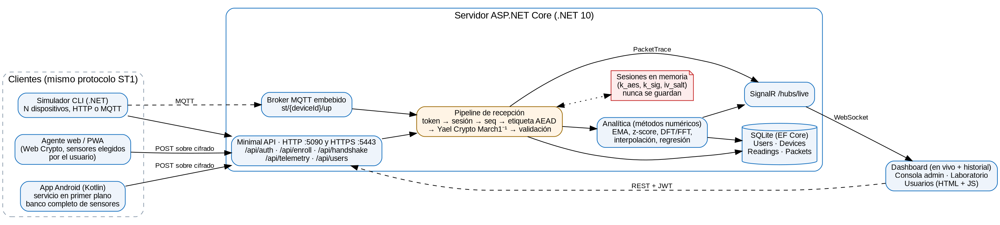
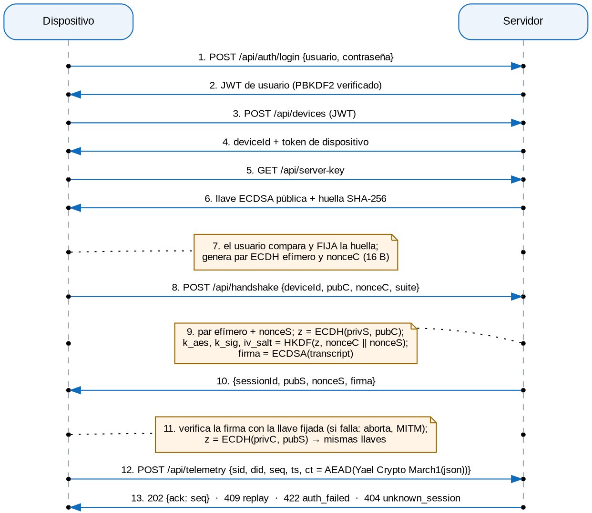
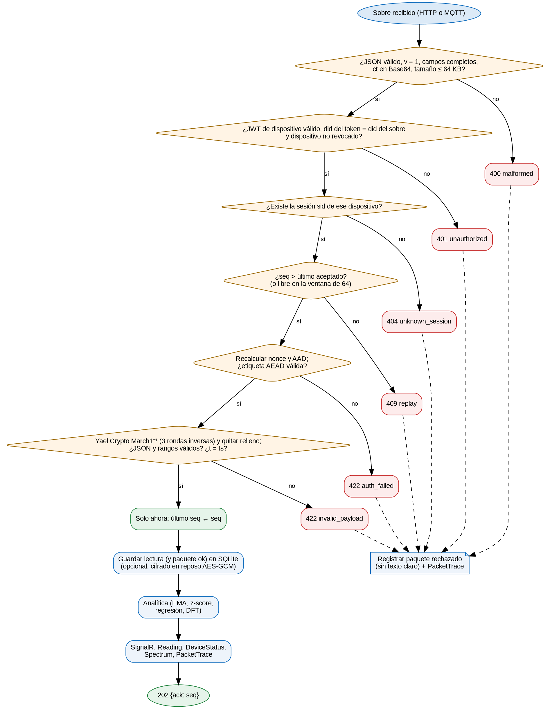
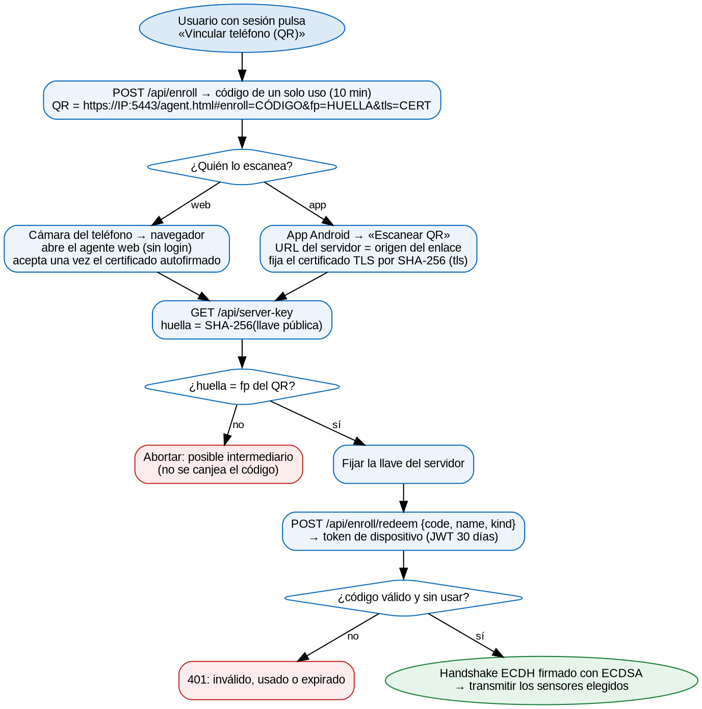

# Arquitectura

**SignalTrace** es un sistema de **rastreo de señales**. Teléfonos (navegador o app Android) y dispositivos simulados envían cada pocos segundos telemetría **cifrada de extremo a extremo** a un servidor .NET. La telemetría sale del **banco de sensores** del teléfono, y el usuario elige qué sensores expone:

- **movimiento:** acelerómetro (con su espectro de vibración), aceleración lineal, gravedad y giroscopio;
- **orientación:** magnetómetro y orientación (azimut, cabeceo y alabeo);
- **entorno:** luz, proximidad, presión barométrica, temperatura, humedad y pasos;
- **batería:** nivel, carga, temperatura y voltaje;
- **señales:** calidad del enlace medida por la propia app, tipo de red e intensidad Wi-Fi y celular.

El sistema **no recolecta la ubicación**: no hay GPS, ni SSID, BSSID o identificadores de celda.

El servidor verifica y descifra cada paquete, lo guarda, calcula métricas con métodos numéricos y muestra en un dashboard los valores instantáneos de cada sensor y su historial. Una **consola de administrador** muestra la encriptación paso a paso, y un **laboratorio** ejecuta ataques reales contra el protocolo.



## Componentes

| Componente | Tecnología | Función |
|---|---|---|
| Servidor | C# / .NET 10, ASP.NET Core Minimal APIs, SignalR, EF Core + SQLite | API REST, handshake, recepción y validación de paquetes, analítica, tiempo real, usuarios, HTTPS para la red local |
| `SignalTrace.Core` | Biblioteca C# sin dependencias externas (solo `System.Security.Cryptography`) | Yael Crypto March1, handshake, sobre AEAD, DTOs, criptoanálisis de Yael Crypto March1. La usan el servidor, el simulador y las pruebas |
| Cliente web | HTML + CSS + JavaScript (módulos ES, sin framework), Web Crypto | Login, agente de telemetría (PWA) con selección de sensores, dashboard en vivo con historial, consola, laboratorio, usuarios |
| App Android | Kotlin + Jetpack Compose, JCA (`javax.crypto`), servicio en primer plano | Telemetría continua con la pantalla bloqueada; banco completo de sensores configurable; Wi-Fi y celular |
| Simulador | Consola .NET, MQTTnet | N dispositivos virtuales con anomalías y huecos, por HTTP o MQTT |
| Broker MQTT | MQTTnet embebido en el servidor | Transporte alternativo: el mismo sobre cifrado en `st/{deviceId}/up` |
| Base de datos | SQLite | Usuarios, dispositivos, lecturas y paquetes (incluidos los rechazados). Las llaves de sesión **nunca** se guardan |

## Flujo general



1. El usuario inicia sesión. La contraseña se verifica con PBKDF2 y recibe un JWT firmado con HMAC-SHA256.
2. El teléfono obtiene un token de dispositivo de una de dos formas:
   - **con el QR del dashboard:** es una URL normal. La cámara del teléfono abre el agente web y la app Android la escanea. El código de un solo uso basta, sin iniciar sesión en el teléfono;
   - **registrándose** con usuario y contraseña.
3. El teléfono descarga la llave pública ECDSA del servidor y la **fija**. Con el QR, la huella viene en el enlace y se comprueba sola. Sin QR, el usuario la **compara** con la que el servidor imprime al arrancar.
4. **Handshake:** ECDH efímero, HKDF para las llaves de sesión y firma ECDSA del transcript, que el cliente verifica con la llave fijada.
5. Cada lectura se cifra con **Yael Crypto March1** y luego con **AES-256-GCM**, y se envía en serie. Cada paquete lleva un `seq` estrictamente creciente.
6. El servidor valida en un orden estricto (siguiente diagrama), guarda la lectura, actualiza la analítica y la difunde por SignalR.



**Vinculación por QR.** El QR es una URL normal. Lleva el código de un solo uso, la huella de la llave del servidor y la del certificado TLS. El cliente comprueba la huella antes de canjear el código:



## Formato del sobre y del contenido

El sobre (`POST /api/telemetry`, con `Authorization: Bearer <token de dispositivo>`):

```
{ "v": 1, "sid": "a1b2c3d4e5f60718", "did": "6f1c2a3e-8b4d-4c5e-9a7f-0123456789ab",
  "seq": 1, "ts": 1760000000000, "ct": "<base64(ciphertext ‖ tag)>" }
```

El contenido en claro (antes de cifrar) es un JSON compacto. Todos los bloques son opcionales salvo `t` y `src`, y solo aparecen los de los sensores que el usuario expone. El servidor valida el rango de cada valor:

```
{ "t": 1760000000000, "src": "android",
  "mot":  { "ax": 0.1, "ay": 0.0, "az": 9.8, "rms": 0.05, "peak": 0.3, "fs": 32, "mag": [ … 64 muestras … ] },
  "lin":  { "x": 0.02, "y": -0.01, "z": 0.03 },          aceleración lineal, m/s²
  "grv":  { "x": 0.05, "y": -0.02, "z": 9.80 },          gravedad, m/s²
  "gyr":  { "x": 0.01, "y": -0.02, "z": 0.05 },          giroscopio, rad/s
  "mfl":  { "x": 21.4, "y": -6.2, "z": -38.0 },          campo magnético, µT
  "ori":  { "az": 182.5, "pi": -3.1, "ro": 1.2 },        azimut, cabeceo y alabeo, grados
  "env":  { "lux": 320, "prx": 5, "hpa": 779.4, "tmp": 23.5, "hum": 44 },
  "stp":  { "n": 128 },                                  pasos desde que inició la transmisión
  "bat":  { "lvl": 0.87, "chg": false, "temp": 30.1, "volt": 4.02, "health": "good", "plug": "none" },
  "net":  { "type": "wifi", "probe": { "rtt": 41.2, "jit": 3.1, "loss": 0.0, "kbps": 5200 } },
  "wifi": { "rssi": -61, "freq": 5180, "link": 433, "tx": 433, "rx": 390 },
  "cell": { "type": "LTE", "dbm": -98, "level": 3, "rsrp": -98, "rsrq": -11, "snr": 8 },
  "app":  { "vis": true, "ver": "2.0.0" } }
```

## Estructura del repositorio

```
Examen_SignalTrace/
├─ reference/                vectores de prueba (fuente de verdad) e implementaciones de referencia
├─ src/SignalTrace.Core/     criptografía y protocolo (C#)
├─ src/SignalTrace.Server/   API, SignalR, SQLite, analítica, laboratorio, MQTT, wwwroot (cliente web)
├─ src/SignalTrace.Simulator/
├─ android/                  app Kotlin + Compose
├─ tests/                    xUnit (Core y Server) y node --test (JS)
├─ docs/                     esta documentación, diagramas y capturas
└─ deploy/                   Dockerfile, docker-compose, guía de despliegue
```
