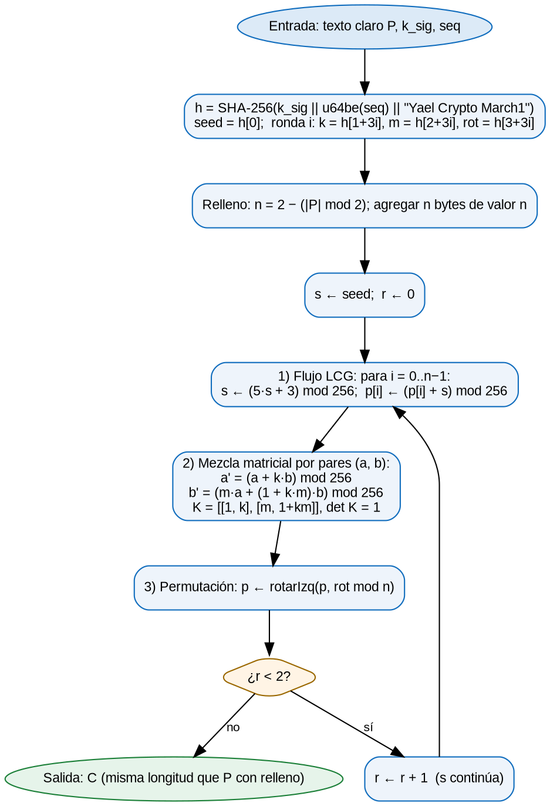
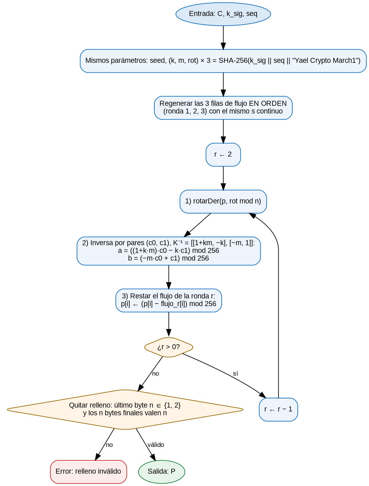
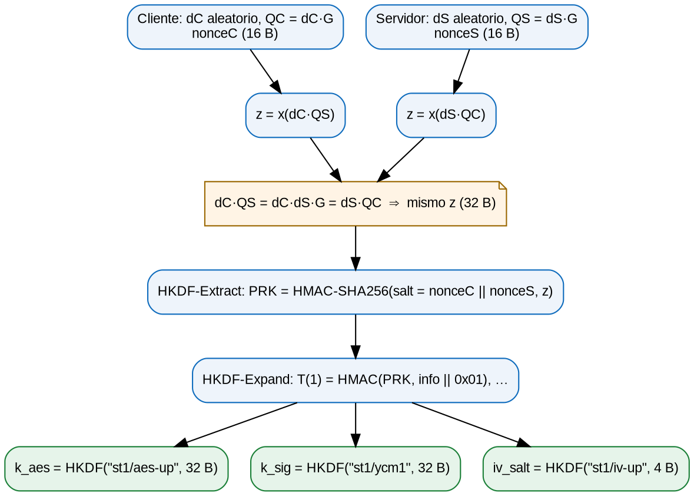
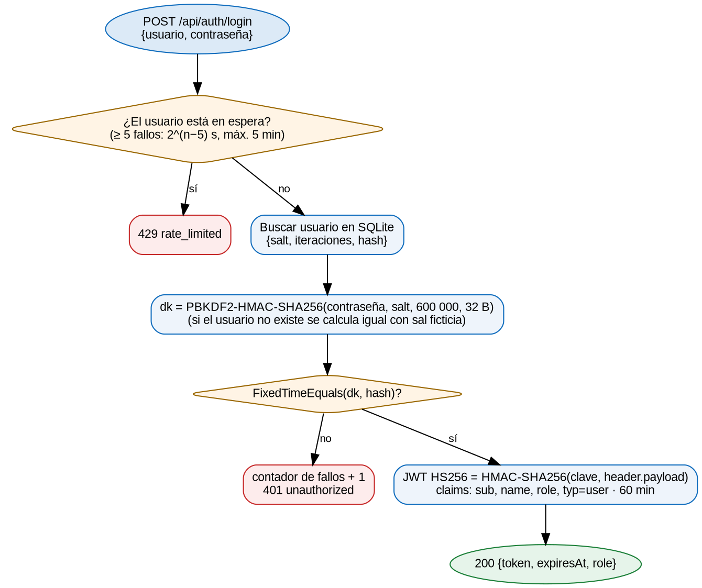

# Algoritmos de cifrado

SignalTrace usa **un algoritmo inventado**, Yael Crypto March1 (abreviado **YCM1**), y **siete algoritmos comerciales**. Todos los ejemplos numéricos de este capítulo salen de los vectores de prueba (`reference/test-vectors.json`). Las tres implementaciones (C#, JavaScript y Kotlin) los reproducen byte a byte en sus pruebas automáticas.

| # | Algoritmo | Tipo | Para qué se usa en SignalTrace | Archivo principal |
|---|---|---|---|---|
| 1 | **Yael Crypto March1** | Inventado | Capa interna de ofuscación de cada paquete | `src/SignalTrace.Core/YaelCryptoMarch1.cs` |
| 2 | **AES-256-GCM** | Comercial (NIST) | Cifrado autenticado de cada paquete | `src/SignalTrace.Core/PacketCrypto.cs` |
| 3 | **ECDH P-256 + HKDF-SHA256** | Comercial | Acuerdo de llaves de sesión y derivación de subllaves | `src/SignalTrace.Core/Protocol.cs` |
| 4 | **ECDSA P-256 / SHA-256** | Comercial | El servidor firma el handshake (evita el MITM) | `src/SignalTrace.Core/Protocol.cs` |
| 5 | **PBKDF2-HMAC-SHA256** | Comercial | Almacenamiento de contraseñas | `src/SignalTrace.Server/Services/Security.cs` |
| 6 | **HMAC-SHA256 (JWT HS256)** | Comercial | Firma de los tokens de sesión | `src/SignalTrace.Server/Services/Security.cs` |
| 7 | **SHA-256** | Comercial | Huellas (llave del servidor y certificado TLS) y parámetros de Yael Crypto March1 | (en varios) |
| 8 | **ChaCha20-Poly1305** | Comercial (RFC 8439) | Suite alternativa a AES-GCM, se elige en el handshake | `PacketCrypto.cs`, `session.js` |

Así se combinan para un paquete de telemetría:

```
JSON en claro
  -> Yael Crypto March1(k_sig, seq)                          [algoritmo propio]
  -> AES-256-GCM(k_aes, nonce, AAD) = ct || tag  [cifrado autenticado]
  -> HTTP POST /api/telemetry
Llaves de sesión: k_sig, k_aes, iv_salt = HKDF(ECDH(efímeras), nonceC || nonceS)
                  en un handshake firmado con ECDSA (huella fijada por el cliente)
```

## 1. Yael Crypto March1 (algoritmo propio)

**Para qué se usa.** Es la capa interna que transforma el JSON de cada lectura antes de cifrarlo con AES-GCM. Muestra en un algoritmo pequeño, que se puede seguir a mano, las tres ideas de la materia: sustitución con flujo, mezcla lineal y permutación. **No es seguro por sí solo** (ver el capítulo de criptoanálisis), por eso siempre va *dentro* de AES-256-GCM.

**Idea matemática.** Cada ronda trabaja sobre bytes, es decir, en el anillo Z₂₅₆:

1. **Suma de flujo** con un generador lineal congruencial (LCG) `s ← (5·s + 3) mod 256`. Por el teorema de Hull–Dobell tiene periodo completo de 256: `c = 3` es impar y `a − 1 = 4` es múltiplo de 4, con módulo potencia de 2.
2. **Mezcla matricial** de cada par de bytes con `K = [[1, k], [m, 1 + k·m]]`. Su determinante es `(1 + km) − km = 1`, así que K es **invertible módulo 256 para cualquier k y m**, y su inversa es `K⁻¹ = [[1 + km, −k], [−m, 1]]`. No hace falta Gauss-Jordan ni el inverso modular.
3. **Permutación**: rotación circular de las posiciones.

Los parámetros cambian **en cada paquete**: `h = SHA-256(k_sig ‖ u64be(seq) ‖ "YCM1")`, `seed = h[0]` y, para la ronda i, `k = h[1+3i]`, `m = h[2+3i]`, `rot = h[3+3i]`. Hay 3 rondas.

**Pasos para cifrar:**

1. Calcular `h` y obtener `seed` y los parámetros `(k, m, rot)` de las 3 rondas.
2. Rellenar: agregar `n` bytes de valor `n`, con `n = 2 − (longitud mod 2)`. Siempre se rellena, así que la longitud final es par.
3. `s ← seed`. Para cada ronda r = 1, 2, 3:
   1. Para cada byte: `s ← (5s + 3) mod 256` y `p[i] ← (p[i] + s) mod 256`. El valor de `s` continúa de una ronda a otra.
   2. Para cada par `(a, b)`: `a' = a + k·b`, `b' = m·a + (1 + k·m)·b`, ambos mod 256.
   3. `p ← rotarIzq(p, rot mod n)`.

**Pasos para descifrar:** se regeneran primero las tres filas de flujo en orden. Luego, de la ronda 3 a la 1, se aplica `rotarDer`, después `K⁻¹` y por último se resta el flujo. Al final se valida y se quita el relleno.





**Pseudocódigo:**

```
función YCM1.Cifrar(P, k_sig, seq):
    h ← SHA256(k_sig ‖ u64be(seq) ‖ "YCM1")
    seed ← h[0];  para i en 0..2: (k_i, m_i, rot_i) ← (h[1+3i], h[2+3i], h[3+3i])
    n_pad ← 2 − (|P| mod 2);  p ← P ‖ [n_pad] × n_pad;  n ← |p|;  s ← seed
    para r en 0..2:
        para i en 0..n−1:  s ← (5·s + 3) mod 256;  p[i] ← (p[i] + s) mod 256
        para i en 0, 2, 4, …:  (a, b) ← (p[i], p[i+1])
            p[i]   ← (a + k_r·b) mod 256
            p[i+1] ← (m_r·a + (1 + k_r·m_r)·b) mod 256
        p ← rotarIzq(p, rot_r mod n)
    devolver p

función YCM1.Descifrar(C, k_sig, seq):
    mismos parámetros;  s ← seed
    para r en 0..2: para i en 0..n−1: s ← (5·s + 3) mod 256; flujo[r][i] ← s
    p ← C
    para r en 2..0:
        p ← rotarDer(p, rot_r mod n)
        para cada par (c0, c1):  a ← ((1+k·m)·c0 − k·c1) mod 256;  b ← (−m·c0 + c1) mod 256
        para i: p[i] ← (p[i] − flujo[r][i]) mod 256
    validar relleno (último byte ∈ {1, 2} y repetido) y quitarlo
```

**Ejemplo de mano** (1 ronda, sin rotación ni relleno): "Hi" = (72, 105), seed = 7, k = 3, m = 5.

| Paso | Cálculo | Resultado |
|---|---|---|
| Flujo | s₁ = 5·7 + 3 = **38**; s₂ = 5·38 + 3 = 193 | (38, 193) |
| Suma | (72 + 38, 105 + 193) mod 256 | (110, 42) |
| Matriz K | K = [[1, 3], [5, 1 + 15]] = [[1, 3], [5, 16]], det = 16 − 15 = 1 | |
| Mezcla | a' = 110 + 3·42 = 236; b' = 5·110 + 16·42 = 1222 ≡ 198 (mod 256) | **(236, 198)** |
| Inversa | K⁻¹ = [[16, −3], [−5, 1]]: 16·236 − 3·198 = 3182 ≡ 110; −5·236 + 198 = −982 ≡ 42 | (110, 42) |
| Restar flujo | (110 − 38, 42 − 193) mod 256 | (72, 105) = "Hi" |

**Ejemplo real** (paquete 1 de los vectores). Con `k_sig = 69503229…5eb7b4e5` y `seq = 1`, los parámetros son seed = 31 y (k, m, rot) = (178, 68, 178), (30, 183, 105), (67, 230, 207). El JSON de 188 bytes (acelerómetro, orientación, luz y batería) se rellena a 190 bytes (`…7d7d0202`). Así evoluciona:

| Etapa | Primeros bytes (hex) |
|---|---|
| texto claro | `7b2274223a313736303030303030…` (`{"t":1760000000…`) |
| r1.stream | `193bf4a5cc0e8bdd769118bbead5…` |
| r1.matrix | `1f77aedd882e35f148b11eb304e5…` |
| r1.rotate | `f15932bb3b6f350a450caaff1f77…` |
| r2.rotate | `c80b038a3d726b8c72e7b7c1617a…` |
| r3.rotate (salida) | `eb5f934c79bd9fa0e9b771e4ab48…` |

**Dónde está:** `YaelCryptoMarch1.cs` (C#), `wwwroot/js/crypto/ycm1.js` (JS) y `android/…/crypto/YaelCryptoMarch1.kt` (Kotlin). La consola de administrador muestra cada etapa de cada paquete real.

## 2. AES-256-GCM (cifrado autenticado)

**Para qué se usa.** Cifra y autentica cada paquete. Es la capa que da la **seguridad real**: confidencialidad (AES-256 en modo contador) e integridad y autenticidad (etiqueta GHASH de 128 bits). Además autentica sin cifrar los metadatos del sobre (AAD).

**Idea matemática.** AES es una red de sustitución-permutación sobre bloques de 128 bits con 14 rondas para llaves de 256 bits. Cada ronda hace SubBytes (inverso en GF(2⁸) más una transformación afín), ShiftRows, MixColumns (multiplicación de matrices en GF(2⁸)) y AddRoundKey. En el modo GCM, AES genera un flujo `E_k(nonce ‖ contador)` que se combina con XOR con el texto. La etiqueta es un polinomio evaluado en `H = E_k(0¹²⁸)` dentro de GF(2¹²⁸) sobre el AAD y el texto cifrado.

**Pasos en SignalTrace:**

1. `nonce` (12 B) = `iv_salt` (4 B, sale de HKDF) ‖ `u64be(seq)`. El seq crece estrictamente, así que **el nonce nunca se repite** con la misma llave.
2. `AAD` = `"ST1"` ‖ `utf8(deviceId)` ‖ `u64be(seq)` ‖ `u64be(ts)`.
3. `ct ‖ tag = AES-256-GCM.Cifrar(k_aes, nonce, salida_de_YCM1, AAD)`, con una etiqueta de 16 B.
4. El servidor recalcula el nonce y el AAD a partir del sobre y verifica la etiqueta **antes** de usar cualquier byte. Si alguien modificó `ct`, `seq`, `ts` o `did`, la verificación falla y responde `422 auth_failed`.

```
función Sellar(llaves, did, seq, ts, json):
    sm    ← YCM1.Cifrar(json, llaves.k_sig, seq)
    nonce ← llaves.iv_salt ‖ u64be(seq)
    aad   ← "ST1" ‖ utf8(did) ‖ u64be(seq) ‖ u64be(ts)
    devolver AES256GCM.Cifrar(llaves.k_aes, nonce, sm, aad)        // ct ‖ tag (16 B)

función Abrir(llaves, did, seq, ts, ct_tag):
    sm ← AES256GCM.Descifrar(...)   // lanza error si la etiqueta no coincide → 422
    devolver YCM1.Descifrar(sm, llaves.k_sig, seq)
```

**Ejemplo (vectores):** k_aes = `b8f98f7e…2487b680`, nonce = `d60f0bea 0000000000000001`. El AAD es `"ST1"` + `"6f1c2a3e-8b4d-4c5e-9a7f-0123456789ab"` + seq 1 + ts `0x00000199c82cc000` (1 760 000 000 000 ms). Resultado: `ct‖tag = 0aee41936d6b8276…86c43c8c` (206 B = 190 B de Yael Crypto March1 + 16 B de etiqueta). Al invertir un solo bit del texto cifrado, la etiqueta deja de coincidir.

**Dónde está:** `PacketCrypto.cs` (`new AesGcm(key, 16)`), `session.js` (`crypto.subtle.encrypt({name:"AES-GCM"})`) y `Protocol.kt` (`AES/GCM/NoPadding`).

## 3. ECDH P-256 + HKDF-SHA256 (llaves de sesión)

**Para qué se usa.** Cada vez que un dispositivo se conecta (handshake), él y el servidor acuerdan un **secreto compartido nuevo** sin enviarlo nunca por la red. De ese secreto se derivan tres subllaves independientes. Cada sesión tiene llaves nuevas (*forward secrecy* respecto a la llave de largo plazo).

**Idea matemática.** Se trabaja con la curva elíptica NIST P-256: y² = x³ − 3x + b sobre 𝔽ₚ, con p = 2²⁵⁶ − 2²²⁴ + 2¹⁹² + 2⁹⁶ − 1. Cada parte elige un escalar secreto `d` y publica `Q = d·G`. Como la multiplicación escalar es conmutativa, `d_C·Q_S = d_C·d_S·G = d_S·Q_C`. Ambos obtienen el mismo punto y usan su coordenada x (32 B) como `z`. Calcular `d` a partir de `Q` es el problema del logaritmo discreto en curvas elípticas. HKDF (RFC 5869) convierte `z` en llaves uniformes en dos pasos. El primero es **Extract**: `PRK = HMAC-SHA256(salt, z)`. El segundo es **Expand**: `T(i) = HMAC(PRK, T(i−1) ‖ info ‖ i)`.

**Pasos:**

1. El cliente genera un par efímero (d_C, Q_C) y `nonceC` (16 B aleatorios). Envía Q_C (65 B: `04‖X‖Y`) y nonceC.
2. El servidor genera (d_S, Q_S) y `nonceS`, y calcula `z = x(d_S·Q_C)`.
3. `salt = nonceC ‖ nonceS` y se derivan:
   - `k_aes = HKDF(z, salt, "st1/aes-up", 32)`
   - `k_sig = HKDF(z, salt, "st1/ycm1", 32)`
   - `iv_salt = HKDF(z, salt, "st1/iv-up", 4)`
4. El cliente recibe Q_S y nonceS, verifica la firma ECDSA (sección 4), calcula `z = x(d_C·Q_S)` y obtiene las mismas tres llaves.



**Ejemplo (vectores con escalares fijos 0x11…11 y 0x22…22):** z = `ccfc261f58193c98…22ca79af6`. Con salt = `000102…0f ‖ 101112…1f` se obtiene k_aes = `b8f98f7e…2487b680`, k_sig = `69503229…5eb7b4e5` (etiqueta `st1/ycm1`) e iv_salt = `d60f0bea`. Las tres implementaciones y Web Crypto en Node coinciden.

**Dónde está:** `EcKeys.SharedSecretX` (`DeriveRawSecretAgreement`) y `SessionKeys.Derive` (`HKDF.DeriveKey`) en C#; `deriveBits` de Web Crypto en JS; `KeyAgreement("ECDH")` y un HKDF escrito a mano con `HmacSHA256` en Kotlin.

## 4. ECDSA P-256 / SHA-256 (firma del handshake)

**Para qué se usa.** ECDH por sí solo no autentica: Mallory podría ponerse en medio y hacer dos handshakes. Para evitarlo, el servidor tiene una **llave de largo plazo** que se genera en el primer arranque y firma el *transcript* de cada handshake. El cliente **fija** la huella SHA-256 de esa llave (*pinning*). Si la firma no se verifica con la llave fijada, aborta.

**Idea matemática.** La llave privada es d y la pública Q = d·G. Para firmar el resumen e = SHA-256(transcript) se elige un k aleatorio y se calcula R = k·G, r = x(R) mod n y s = k⁻¹(e + r·d) mod n. Para verificar se calcula u₁ = e·s⁻¹, u₂ = r·s⁻¹ y se comprueba que x(u₁·G + u₂·Q) ≡ r. Aquí aparecen inversos modulares en 𝔽ₙ (Euclides extendido). La firma va en formato IEEE P1363 `r‖s` (64 B).

**Pasos:**

1. `transcript = "ST1-HS" ‖ Q_C ‖ Q_S ‖ nonceC ‖ nonceS ‖ utf8(deviceId) ‖ utf8(sessionId)`. Si la suite no es AES-GCM, también se le concatena `"|" + suite`.
2. El servidor responde con `firma = ECDSA-SHA256(llave_largo_plazo, transcript)`.
3. El cliente reconstruye el transcript con lo que envió y recibió y verifica la firma con la llave fijada.
4. En el primer uso, el usuario compara la huella `SHA-256(llave pública)` mostrada en pantalla con la que el servidor imprime al arrancar (TOFU). Con el QR de vinculación la huella llega dentro del enlace y el cliente la comprueba sola antes de fijarla.

**Ejemplo:** la llave del vector es `0451a7580833…7a81a1`. La firma `24b35ef9…a6e8e0` se verifica sobre el transcript de 220 B (6 + 65 + 65 + 16 + 16 + 36 + 16). Cambiar un solo byte del transcript la invalida. Las firmas ECDSA son aleatorizadas, así que solo se verifican, no se comparan.

**Dónde está:** `Handshake.Sign`/`Verify` (C#), `crypto.subtle.verify({name:"ECDSA"})` (JS) y `Signature("SHA256withECDSA")` (Kotlin, que convierte P1363 a DER).

## 5. PBKDF2-HMAC-SHA256 (contraseñas)

**Para qué se usa.** El servidor nunca guarda contraseñas: guarda `{sal, iteraciones, hash}`.

**Idea matemática.** `DK = T₁` con `T₁ = U₁ ⊕ U₂ ⊕ … ⊕ U_c`, donde `U₁ = HMAC(P, sal ‖ 00000001)` y `U_j = HMAC(P, U_{j−1})`. Con c = 600 000 iteraciones, cada intento de adivinar una contraseña cuesta 600 000 HMAC. Eso hace caros los ataques de diccionario, y la sal aleatoria impide usar tablas precalculadas.

**Pasos:**

1. Alta: generar una sal de 16 B, calcular `hash = PBKDF2(contraseña, sal, 600 000, 32 B)` y guardar los tres valores.
2. Login: recalcular con la sal y las iteraciones guardadas y comparar en **tiempo constante** (`CryptographicOperations.FixedTimeEquals`).
3. Si el usuario no existe se hace el mismo cálculo con una sal ficticia, para no revelar por el tiempo de respuesta qué usuarios existen.
4. A partir de 5 fallos el usuario debe esperar 2^(n−5) segundos (máximo 5 min) y recibe `429`.

**Ejemplo (vector):** contraseña "correct horse battery staple", sal `6465666768696a6b6c6d6e6f70717273`, 600 000 iteraciones → `b9979d3cf8ed3e797709d369c59d7b6fd84e4fcca236c9815a48cd81a5abf3bf`.



## 6. HMAC-SHA256 (tokens JWT HS256)

**Para qué se usa.** Después del login, cada petición lleva un JWT: `base64url(header) . base64url(payload) . base64url(HMAC-SHA256(clave, header.payload))`. El servidor recalcula el HMAC; si alguien cambia el rol o la expiración, la firma no coincide.

Hay dos tipos de token:

- **Usuario:** `typ=user`, `role` y 60 minutos de vigencia.
- **Dispositivo:** `typ=device`, `did` y 30 días de vigencia. Solo autoriza el handshake y el envío de telemetría, y se puede revocar desde el dashboard.

La clave es de 32 B. Se genera en el primer arranque y se guarda en `data/jwt.key`, o se configura con `Jwt__Key`.

## 7. SHA-256

Se usa en tres lugares:

- La **huella** de la llave del servidor: `hex(SHA-256(llave pública de 65 B))`.
- La huella del **certificado TLS** autofirmado de la red local: `hex(SHA-256(certificado DER))`. Viaja en el QR y la app Android la fija (*certificate pinning*).
- La **derivación de los parámetros de Yael Crypto March1** por paquete.
- Dentro de HMAC, HKDF, PBKDF2 y ECDSA.

## 8. ChaCha20-Poly1305 (suite alternativa)

Es un cifrado autenticado (RFC 8439) que sustituye a AES-GCM cuando el dispositivo no tiene AES por hardware. ChaCha20 es un generador de flujo ARX (sumas, rotaciones y XOR sobre palabras de 32 bits) y Poly1305 es un MAC polinomial módulo 2¹³⁰ − 5. Se negocia en el handshake con el campo `suite`. La suite elegida va firmada dentro del transcript, de modo que Mallory no puede forzar otra. Las llaves salen de HKDF con `info = "st1/c20-up"`.

- En .NET se usa `ChaCha20Poly1305`.
- En el navegador, `@noble/ciphers` (Web Crypto no la incluye). Una prueba verifica que da los mismos bytes que OpenSSL.
- En Android, el JCA (API 28 o superior).

## 9. TLS en la red local con certificado fijado

**Para qué se usa.** El navegador del teléfono solo permite Web Crypto y los sensores en un **contexto seguro**, es decir, con HTTPS o `localhost`. Por eso el servidor también escucha en `https://<IP>:5443`. Al primer arranque genera un certificado autofirmado ECDSA P-256 (`data/lan-cert.pfx`) con las IP de la máquina en el *Subject Alternative Name*.

**Cómo se confía en un certificado autofirmado:**

- **Navegador:** muestra un aviso la primera vez y el usuario lo acepta. Aunque alguien interceptara ese TLS, la telemetría sigue protegida: va cifrada de extremo a extremo con las llaves del handshake firmado, y la huella de la llave del servidor llegó en el QR.
- **App Android:** no pregunta. El QR trae `tls = SHA-256(certificado DER)` y la app instala un `X509TrustManager` (`PinnedCertTrust`) que **solo** acepta un certificado con esa huella exacta (*certificate pinning*). Cualquier otro se rechaza, aunque esté firmado por una autoridad pública.
