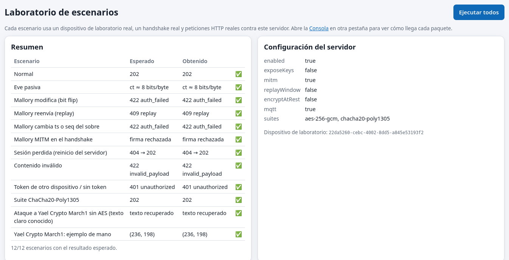
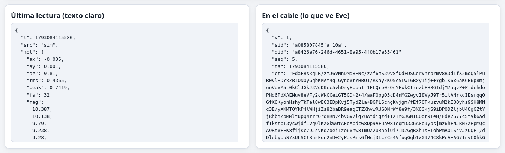
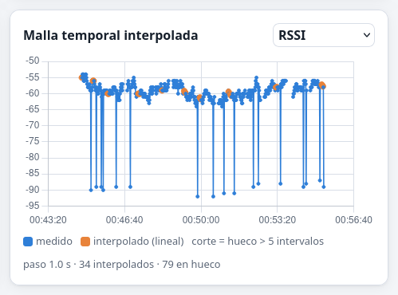
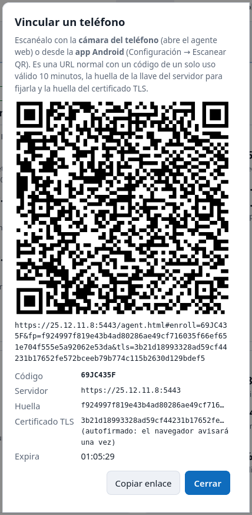

# Escenarios

Cada escenario indica sus precondiciones, los pasos, el resultado esperado y el resultado obtenido. Los escenarios de ataque se ejecutan en vivo desde **Laboratorio → Ejecutar todos** con un dispositivo real, un handshake real y peticiones HTTP reales. Los resultados de la tabla de resumen son los de la última ejecución.

**Personajes:** *Alicia* es el dispositivo legítimo, *Eve* escucha la red de forma pasiva y *Mallory* es una atacante activa que puede modificar, reenviar o interceptar mensajes.

| Escenario | Qué ocurre | Esperado | Obtenido |
|---|---|---|---|
| Normal | Handshake firmado y una lectura | 202 | 202 ✅ |
| Eve pasiva | Captura del tráfico | El cable solo muestra `ct` con entropía cercana a 8 bits/byte | ✅ |
| Mallory modifica (bit flip) | Invierte un bit de `ct` y reenvía | 422 auth_failed | ✅ |
| Mallory reenvía (replay) | Reenvía un paquete válido | 409 replay | ✅ |
| Mallory altera `ts` | Cambia el `ts` del sobre (va en el AAD) | 422 auth_failed | ✅ |
| Mallory MITM en el handshake | El servidor firma con una llave distinta de la fijada | El cliente rechaza la firma | ✅ |
| Sesión perdida | Reinicio del servidor: se borran las sesiones | 404 y luego un nuevo handshake con 202 | ✅ |
| Contenido inválido | Paquete auténtico con humedad relativa de 140 % | 422 invalid_payload | ✅ |
| Token ajeno o sin token | `did` distinto al del token | 401 | ✅ |
| Suite ChaCha20-Poly1305 | Handshake que negocia ChaCha20 | 202 | ✅ |
| Ataque a Yael Crypto March1 sin AES | Texto claro conocido contra 1 ronda | Se recupera el texto | ✅ (por eso Yael Crypto March1 va dentro de AES) |
| Ejemplo de mano de Yael Crypto March1 | "Hi" con seed 7, k 3, m 5 | (236, 198) | ✅ |

## E1 · Funcionamiento normal

- **Precondiciones:** el usuario inició sesión, el dispositivo está registrado y la huella del servidor está fijada.
- **Pasos:** el agente hace el handshake (ECDH + HKDF + verificación ECDSA) y envía lecturas cada *n* segundos.
- **Resultado:** cada paquete recibe `202 {ack: seq}`. El dashboard grafica la lectura en menos de un segundo y la consola muestra el paquete etapa por etapa.

## E2 · Eve pasiva (escucha de la red o del túnel)

- **Precondiciones:** Eve ve todos los bytes que viajan entre el teléfono y el servidor.
- **Pasos:** se envía una lectura y se compara el texto claro con el sobre capturado.
- **Resultado:** Eve ve `sid`, `did`, `seq` y `ts`, que son metadatos autenticados pero no cifrados. **No** ve ningún valor de los sensores: ni la orientación, ni la luz, ni la batería, ni la red. La entropía del texto cifrado se acerca a 8 bits/byte, contra unos 4.5 del JSON.

## E3 · Mallory modifica un paquete

- **Pasos:** se invierte un bit del texto cifrado (o de la etiqueta) y se reenvía el sobre.
- **Resultado:** `422 auth_failed`. La etiqueta GCM no coincide y el servidor no usa ningún byte del paquete. **El número de secuencia no se consume**: el paquete original con el mismo `seq` se acepta después. El servidor actualiza `lastSeq` solo tras autenticar y validar; así Mallory no puede «quemar» números de secuencia.

## E4 · Mallory reenvía (replay)

- **Pasos:** se envía un paquete válido y luego exactamente el mismo.
- **Resultado:** el primero recibe `202` y el segundo `409 replay`. Con `Telemetry:ReplayWindow=true`, una ventana deslizante de 64 bits acepta paquetes desordenados dentro de los últimos 64 `seq`, pero rechaza los duplicados. Hay prueba automática.

## E5 · Mallory cambia `ts`, `seq` o `did` del sobre

- **Resultado:** `422 auth_failed`. Los tres van en el **AAD** (`"ST1" ‖ did ‖ seq ‖ ts`) y el `seq` va además en el nonce. Cambiar cualquiera rompe la etiqueta.

## E6 · Mallory en medio del handshake (MITM)

- **Precondiciones:** el cliente fijó la huella del servidor legítimo. Con `Lab:EnableMitmDemo=true` el servidor firma con otra llave, como haría Mallory.
- **Resultado:** el cliente verifica la firma ECDSA del transcript con la llave fijada, la firma falla y **aborta antes de derivar llaves**. En la app Android, si la llave del servidor cambia, la pantalla de configuración avisa del posible ataque.

## E7 · Sesión perdida (reinicio del servidor)

- **Resultado:** el siguiente paquete recibe `404 unknown_session`. El agente (web, Android o simulador) repite el handshake automáticamente con llaves nuevas y continúa. Las sesiones solo viven en memoria a propósito.

## E8 · Pantalla bloqueada o pestaña oculta (web)

- **Resultado:** el navegador detiene los sensores y los temporizadores. El agente muestra «En pausa» y en los datos queda un **hueco**. El dashboard re-muestrea sobre una malla temporal regular:
  - los huecos de hasta 5 intervalos se rellenan por **interpolación lineal**, marcados en naranja;
  - los más largos quedan como corte.

## E9 · Pantalla bloqueada (Android)

- **Resultado esperado:** la telemetría continúa gracias al servicio en primer plano (tipo `specialUse`) y su notificación permanente. *No se probó en un dispositivo físico en esta entrega (ver Limitaciones). El flujo completo de la app sí se probó contra el servidor real con pruebas JVM.*

## E10 · Lectura anómala

- **Pasos:** el simulador con `--anomalies` inyecta caídas de señal de 30 dB, picos de RTT de más de 600 ms y vibración fuerte.
- **Resultado:** el servidor calcula el **z-score** de cada muestra de movimiento, RTT y señal frente a las 30 anteriores. El dashboard marca con una ✕ roja en las gráficas las muestras con |z| > 3 y muestra el valor de z junto al dato en vivo. El espectro (DFT) deja ver la frecuencia dominante de la vibración. El sistema no genera alertas: las anomalías se analizan sobre los datos.

## E11 · Sin conexión

- **Pasos:** se detiene el servidor durante unos 10 s con el agente enviando.
- **Resultado:** las lecturas se acumulan **en claro** en la cola local (IndexedDB o archivo, máximo 500). El agente reintenta con *backoff* exponencial (1, 2, 4, 8… s). Al volver la red, la cola se envía en orden y cada lectura se cifra en ese momento con un `seq` nuevo. En la prueba, 15 lecturas en cola se enviaron con 0 rechazos, incluso tras recargar la página.

## E12 · Contraseñas

- **Resultado:** una contraseña incorrecta recibe `401`. Tras 5 fallos, `429` con una espera creciente. Un usuario `viewer` no puede crear usuarios (`403`) ni ver los dispositivos de otros (`403`).

## E13 · Vinculación por QR sin iniciar sesión en el teléfono

- **Precondiciones:** un usuario abre el dashboard y pulsa «Vincular teléfono (QR)».
- **Pasos:** el QR es la URL `https://<IP>:5443/agent.html#enroll=CÓDIGO&fp=HUELLA&tls=CERT`. La cámara del teléfono la abre en el navegador, que avisa una vez del certificado autofirmado. El agente compara la huella de la llave del servidor con la del QR, la fija y canjea el código.
- **Resultado:** el teléfono queda vinculado a la cuenta de quien generó el QR, sin escribir contraseñas, y puede transmitir enseguida. El código sirve una sola vez y expira a los 10 minutos: un segundo canje recibe `401`. Si la huella no coincide, el agente **no** canjea el código y avisa de un posible intermediario. La app Android lee el mismo QR y además fija el certificado TLS.

## E14 · Gestión de usuarios

- **Pasos:** el administrador cambia el rol de un usuario, restablece su contraseña y luego cambia la suya desde el menú de usuario.
- **Resultado:**
  - el cambio de rol se aplica en el siguiente inicio de sesión de ese usuario;
  - el servidor se niega a degradar al último administrador (`400 last_admin`);
  - el restablecimiento genera 16 caracteres aleatorios que se muestran una sola vez; la contraseña anterior deja de funcionar;
  - cambiar la contraseña propia exige la actual (`400 wrong_password` si no coincide) y guarda un PBKDF2 nuevo con sal nueva.

