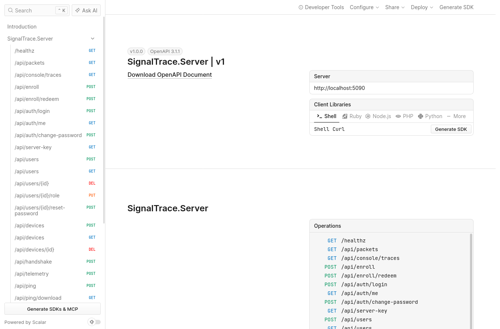

# App Android y API

## App Android (sistema híbrido)

La app **SignalTrace** para Android (Kotlin + Jetpack Compose) usa **el mismo protocolo y la misma API** que el cliente web. Por eso el sistema es un híbrido real web + móvil. Los dos clientes comparten el mismo banco de sensores y los mismos nombres de campo, pero la app llega a sensores que el navegador no puede leer:

| Sensor | Agente web (Chrome) | App Android |
|---|---|---|
| Acelerómetro, con espectro | Sí (`devicemotion`, solo con la página visible) | Sí (`SensorManager`, remuestreado a 32 Hz) |
| Aceleración lineal y gravedad | Sí (`devicemotion`) | Sí (`TYPE_LINEAR_ACCELERATION`, `TYPE_GRAVITY`) |
| Giroscopio | Sí (`rotationRate`) | Sí (`TYPE_GYROSCOPE`) |
| Magnetómetro | Solo con Generic Sensor API (algunos navegadores) | Sí (`TYPE_MAGNETIC_FIELD`) |
| Orientación | Sí (`deviceorientation`) | Sí (vector de rotación → `getOrientation`) |
| Luz ambiental | Solo con Generic Sensor API (algunos navegadores) | Sí (`TYPE_LIGHT`) |
| **Proximidad, presión, temperatura, humedad, pasos** | **No existe API** | Sí, si el teléfono tiene el sensor |
| Batería | Nivel y carga (Chrome) | Además temperatura, voltaje, salud y alimentación |
| **Wi-Fi: RSSI, frecuencia y velocidades** | **No existe API** | Sí (`WifiInfo`, sin SSID ni BSSID) |
| **Celular: dBm, nivel, RSRP, RSRQ, SNR, tecnología** | **No existe API** | Sí (`TelephonyManager.getSignalStrength`, sin identificadores) |
| Calidad de enlace propia (RTT, jitter, pérdida, kbps) | Sí | Sí |
| Con la pantalla bloqueada | En pausa | Continúa |

**Selección de sensores.**

- En el **agente web** una tabla lista cada sensor con su estado: disponible, no soportado por este navegador o solo en la app Android. El usuario marca los que quiere exponer **antes** de iniciar; la selección queda bloqueada mientras transmite.
- En la **app**, Ajustes → «Sensores expuestos al servidor» tiene un interruptor por sensor. **Por defecto todo el banco está expuesto**, y los sensores que el teléfono no tiene aparecen deshabilitados.

**Sin ubicación.** La app no pide permisos de ubicación ni lee el SSID, el BSSID o los identificadores de celda. Solo pide el permiso de actividad física (para el podómetro) y el de notificaciones.

**Criptografía en la app** (`crypto/Protocol.kt`, `crypto/YaelCryptoMarch1.kt`). Es la tercera implementación del protocolo, escrita con el JCA de Android:

- `KeyPairGenerator("EC")` con `secp256r1` y `KeyAgreement("ECDH")`, que da la coordenada X cruda de 32 B.
- HKDF-SHA256 escrito paso a paso (Extract y Expand con `HmacSHA256`).
- `Signature("SHA256withECDSA")`. La firma P1363 (r‖s) del servidor se convierte a DER antes de verificar.
- `AES/GCM/NoPadding` y `ChaCha20-Poly1305` (Android 9 o superior).
- **Android Keystore:** el token del dispositivo se guarda cifrado con AES-256-GCM, con una llave que no se puede exportar del almacén seguro del teléfono.
- **Certificate pinning:** cuando el QR trae la huella del certificado TLS autofirmado del servidor, OkHttp usa un `X509TrustManager` (`PinnedCertTrust`) que solo acepta ese certificado exacto.

**Componentes:**

- `TelemetryService`: servicio en primer plano de tipo `specialUse`, con notificación permanente, acción «Detener» y *wake lock* parcial.
- `TelemetryEngine`: muestreo, cola persistente en archivo (máximo 500), envío en serie, re-handshake y *backoff*.
- Recolectores: acelerómetro, `SensorBankCollector` (los demás sensores físicos), batería, red, Wi-Fi y celular.
- Tres pantallas: Estado, Configurar (QR, huella y registro) y Ajustes (sensores expuestos, intervalo y suite).
- El ícono es el logo de la tortuga y el pájaro, como ícono adaptable con su versión monocroma.

**Validación sin dispositivo:** en esta computadora no se pudo ejecutar un emulador. La app se validó con **pruebas JVM**:

1. `VectorTest`: 9 pruebas que reproducen byte a byte los vectores de Yael Crypto March1, HKDF, ECDSA y AES-GCM.
2. `ServerIntegrationTest`: con las mismas clases `Api` y `Protocol` de la app, contra el servidor real hace:
   - login;
   - registro;
   - handshake con AES-GCM y con ChaCha20 y envío de paquetes con sensores (202);
   - replay (409);
   - rechazo de una llave fijada distinta (MITM);
   - vinculación por QR sobre **HTTPS con el certificado fijado**, y rechazo de un certificado con otra huella;
   - contraseña incorrecta (401).

Lo único que falta comprobar en un teléfono real es la lectura de los sensores físicos y el servicio con la pantalla bloqueada.


**Compilar la APK:**

```
cd android
./gradlew :app:assembleRelease -PserverUrl=https://mi-tunel   # URL por defecto (opcional; se cambia en la app)
apksigner verify --print-certs app/build/outputs/apk/release/app-release.apk
```

La firma release se lee de `keystore.properties` y `keystore/`, que no se suben al repositorio.

## API REST

Las respuestas de error tienen la forma `{ "code": "…", "message": "…" }`. Los binarios van en Base64 y las fechas en milisegundos epoch. La documentación interactiva está en `/scalar` y el OpenAPI en `/openapi/v1.json`.



| Método y ruta | Autorización | Descripción |
|---|---|---|
| `POST /api/auth/login` | — | `{username, password}` → `{token, expiresAt, role}`; 401 o 429 |
| `GET /api/auth/me` | usuario | Usuario y rol actuales |
| `GET /api/server-key` | — | `{publicKey, fingerprint, suites}` |
| `POST /api/auth/change-password` | usuario | `{current, new}` → 204; `400 wrong_password` si la actual no coincide |
| `GET/POST /api/users`, `DELETE /api/users/{id}` | admin | Alta, lista y baja de usuarios (PBKDF2) |
| `PUT /api/users/{id}/role` | admin | `{role}`; `400 last_admin` si se intenta degradar al último administrador |
| `POST /api/users/{id}/reset-password` | admin | Genera una contraseña aleatoria de 16 caracteres y la devuelve una sola vez |
| `POST /api/devices` | usuario | `{name, kind}` → `{deviceId, deviceToken}` |
| `GET /api/devices` | usuario | Lista con estado, batería y última señal |
| `DELETE /api/devices/{id}` | admin | Revoca y borra |
| `POST /api/enroll` · `POST /api/enroll/redeem` | usuario · — | Código de un solo uso (10 min) y su QR (`…/agent.html#enroll=…&fp=…&tls=…`) · canje por un token de dispositivo |
| `POST /api/handshake` | dispositivo | `{deviceId, clientPublicKey, clientNonce, suite}` → `{sessionId, serverPublicKey, serverNonce, signature, expiresAt, suite}` |
| `POST /api/telemetry` | dispositivo | Sobre cifrado → `202 {ack}`; 400, 401, 404, 409, 422 o 429 |
| `GET /api/readings?from&maxPoints` · `/api/readings/grid` | usuario | Lecturas descifradas con su carga completa (`p`) y z-scores, muestreadas si el rango es largo · malla regular con puntos interpolados |
| `GET /api/export/readings.csv` | usuario | Exportación CSV |
| `GET /api/packets` · `/api/console/traces` | admin | Historial de paquetes · trazas para la consola |
| `POST /api/ping` · `GET /api/ping/download` | — (con límite de tasa) | Sondeo de enlace |
| `GET /api/lab/config` · `POST /api/lab/reset-sessions` · `POST /api/lab/ycm1-attack` | admin + `Lab:Enabled` | Laboratorio |
| `GET /healthz` | — | Estado |
| SignalR `/hubs/live` | usuario | Eventos `Reading`, `DeviceStatus`, `Spectrum` y `PacketTrace` (solo admin); métodos `Subscribe` y `Unsubscribe` |

**Códigos de rechazo de telemetría:**

| Situación | HTTP | `code` |
|---|---|---|
| JSON mal formado o campos faltantes | 400 | `malformed` |
| Token inválido o revocado, o `did` distinto | 401 | `unauthorized` |
| Sesión desconocida o expirada | 404 | `unknown_session` |
| `seq` repetido o menor | 409 | `replay` |
| Etiqueta AEAD inválida | 422 | `auth_failed` |
| Contenido inválido (rango o esquema) | 422 | `invalid_payload` |
| Demasiadas solicitudes | 429 | `rate_limited` |
