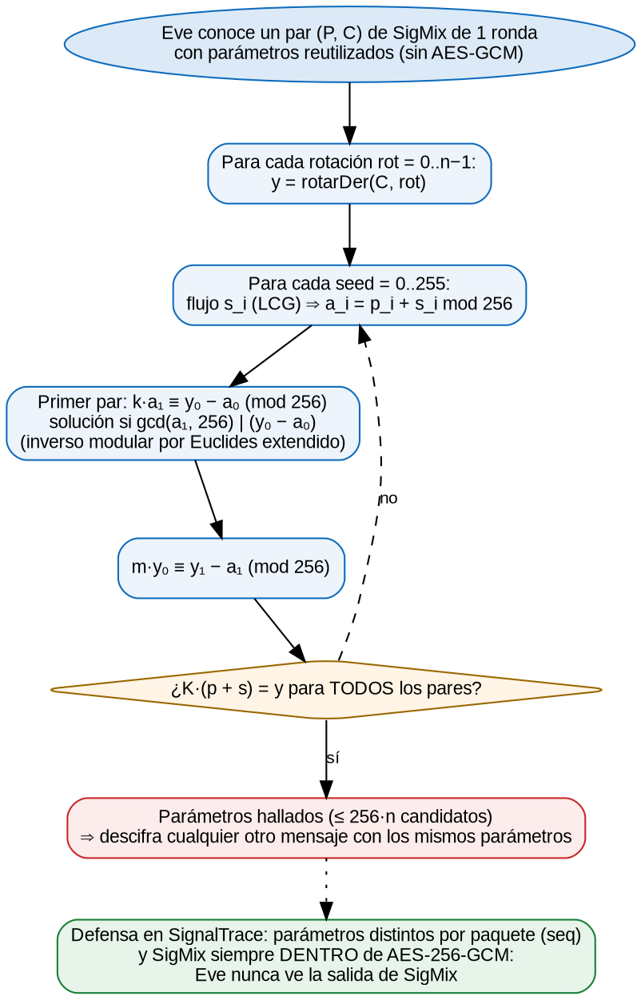

# Criptoanálisis de SigMix

Un algoritmo inventado debe acompañarse de un análisis honesto de sus límites. **SigMix no es seguro por sí solo.** En SignalTrace solo aporta valor didáctico y una capa adicional *debajo* de AES-256-GCM.

## Por qué es débil

1. **Es afín sobre Z₂₅₆.** Cada ronda es una suma de un vector constante (el flujo), una multiplicación por una matriz invertible y una permutación. La composición de transformaciones afines es afín: `C = A·P + B (mod 256)`, con A y B fijas para unos parámetros dados. Es la misma debilidad del **cifrado de Hill**: con suficientes pares conocidos de texto claro y cifrado se resuelve el sistema lineal.
2. **El espacio de parámetros es pequeño.** Hay 10 bytes por paquete (seed más tres tripletas k, m, rot), es decir, 2⁸⁰ combinaciones como máximo. Además las rotaciones se reducen módulo n.
3. **El flujo es un LCG.** Tiene periodo completo, pero es totalmente predecible a partir de un solo valor: conocer `seed` da todo el flujo.

## Ataque de texto claro conocido (1 ronda, parámetros reutilizados)

Eve conoce un mensaje P y su cifrado C, y quiere descifrar otro mensaje C' cifrado con los mismos parámetros, como pasaría si se reutilizaran (equivalente a reutilizar un nonce).



1. Para cada rotación posible `rot ∈ [0, n)` deshace la permutación: `y = rotarDer(C, rot)`.
2. Para cada `seed ∈ [0, 256)` genera el flujo y calcula `a_i = p_i + s_i (mod 256)`.
3. Con el primer par plantea la congruencia lineal **k·a₁ ≡ y₀ − a₀ (mod 256)**:
   - tiene solución si y solo si `g = gcd(a₁, 256)` divide a `y₀ − a₀`;
   - en ese caso hay `g` soluciones: `k = k₀ + t·256/g`, con `k₀ = ((y₀ − a₀)/g)·(a₁/g)⁻¹ mod (256/g)`;
   - el inverso se obtiene con el **algoritmo de Euclides extendido**.
4. Como `a₀ + k·a₁ = y₀`, la segunda ecuación es **m·y₀ ≡ y₁ − a₁ (mod 256)**, que se resuelve igual.
5. Comprueba que `K·(p + s) = y` para **todos** los pares. Si se cumple, encontró los parámetros.
6. Como solo conoce `rot mod n`, para un mensaje de otra longitud prueba los candidatos `rot + j·n ≤ 255` y se queda con el que produce un JSON válido.

Como mucho prueba 256·n candidatos: para un mensaje de 50 bytes, unos 13 000, en milisegundos. El laboratorio lo ejecuta en vivo, `SigMixCryptanalysis.cs` lo implementa y `CryptanalysisTests` lo verifica en 5 casos aleatorios.

```
función AtaqueTextoConocido(P, C):
    p ← relleno(P);  n ← |p|
    para rot en 0..n−1:
        y ← rotarDer(C, rot)
        para seed en 0..255:
            a ← p + flujoLCG(seed)                       (mod 256)
            para k en ResolverLineal(a[1], y[0] − a[0]):    // k·a1 ≡ y0 − a0
                para m en ResolverLineal(y[0], y[1] − a[1]): // m·y0 ≡ y1 − a1
                    si ∀ pares: (a + k·b, m·a + (1+km)·b) = (y_i, y_i+1):
                        devolver (seed, k, m, rot)

función ResolverLineal(a, b):    // todas las x en Z256 con a·x ≡ b
    g ← gcd(a, 256);  si b mod g ≠ 0: devolver ∅
    x0 ← (b/g) · inverso(a/g, 256/g) mod (256/g)      // Euclides extendido
    devolver { x0 + t·256/g  |  t = 0..g−1 }
```

## Por qué en SignalTrace no aplica

- **Parámetros distintos por paquete.** `h = SHA-256(k_sig ‖ seq ‖ "SigMix")` cambia con cada `seq`, y `seq` nunca se repite dentro de una sesión.
- **SigMix nunca queda expuesto.** Eve solo ve la salida de AES-256-GCM. Para atacar SigMix necesitaría primero romper AES-GCM, y en ese caso SigMix ya no importaría.
- **Integridad.** Modificar el paquete se detecta con la etiqueta GCM, no con SigMix. SigMix no ofrece autenticidad.
- **Lección:** la seguridad real del sistema se apoya en primitivas estándar y revisadas (AES-GCM, ECDH, ECDSA, HKDF, PBKDF2). El algoritmo propio va como capa adicional y nunca como única defensa.

## Comparación con César

| | César (+3) | SigMix (3 rondas) sin AES | SigMix + AES-256-GCM |
|---|---|---|---|
| Espacio de llaves | 256 | ≤ 2⁸⁰ por paquete | 2²⁵⁶ (AES) |
| Entropía de la salida | Igual a la del texto (≈ 4.5) | ≈ 6–7 bits/byte | ≈ 8 bits/byte (en capturas largas) |
| Texto claro conocido | Trivial | Roto (1 ronda, en ms) | No aplica |
| Integridad | No | No | Sí (etiqueta de 128 bits) |
