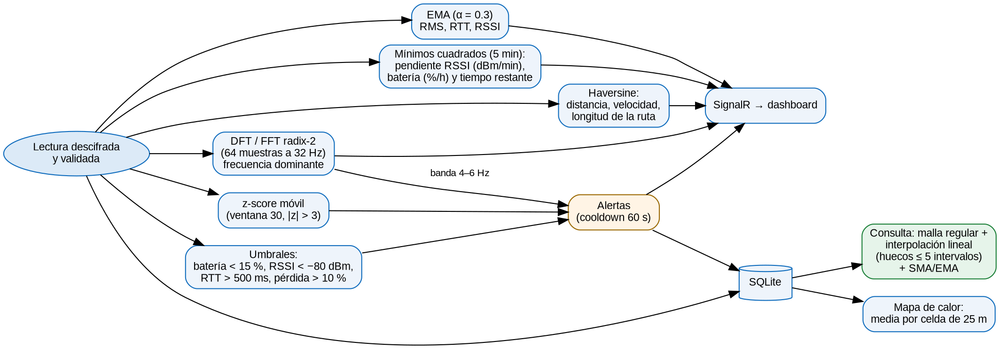
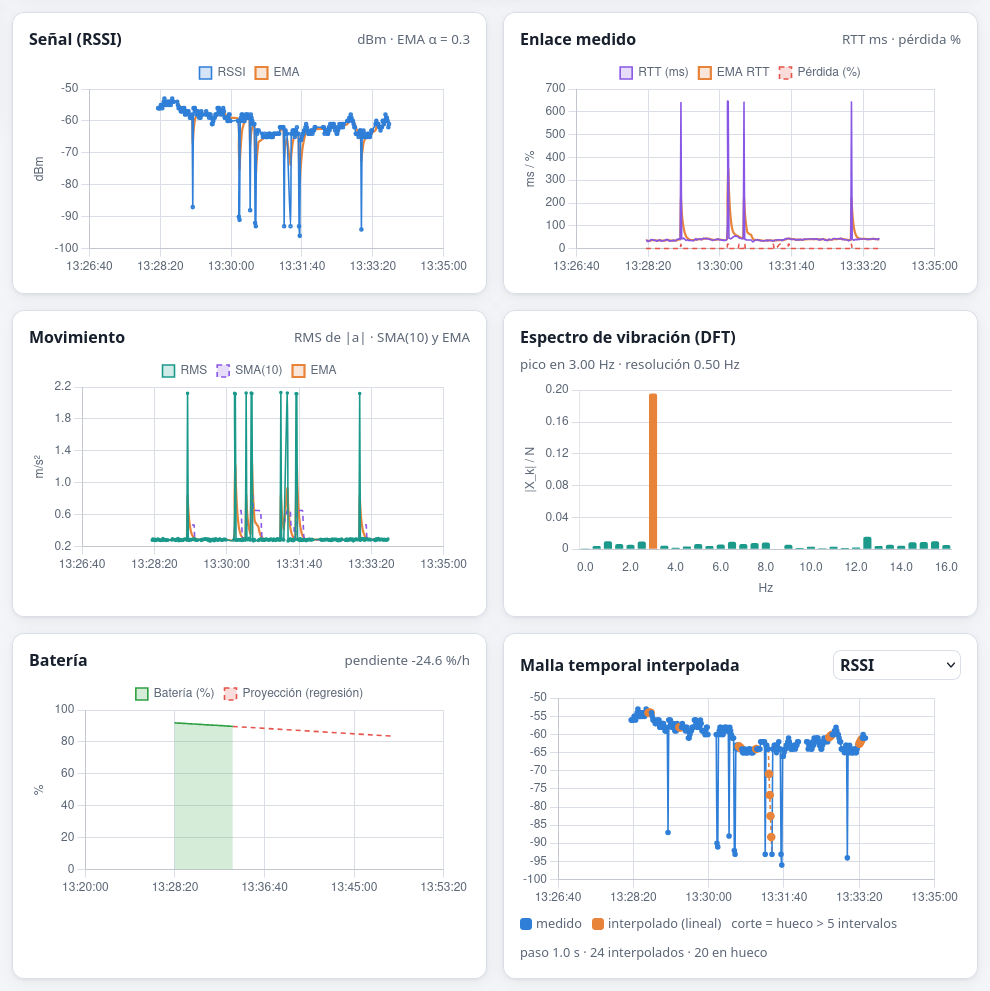

# Matemáticas aplicadas

Este capítulo relaciona las tres «notas adicionales» de la asignación con el código y sus fórmulas.

## Álgebra lineal

| Concepto | Dónde | Fórmula o uso |
|---|---|---|
| Matriz 2×2 con det = 1 e inversa | SigMix, mezcla por pares (`SigMix.cs`) | K = [[1, k], [m, 1 + km]], det K = 1, K⁻¹ = [[1 + km, −k], [−m, 1]] (mod 256) |
| Transformación afín y composición | Criptoanálisis de SigMix | C = A·P + B (mod 256), igual que el cifrado de Hill |
| Sistemas de congruencias lineales | Ataque de texto claro conocido | k·a₁ ≡ y₀ − a₀ y m·y₀ ≡ y₁ − a₁ (mod 256) |
| La DFT como transformación lineal | Espectro de vibración (`Numeric.cs`) | X = F·x con F_{kn} = e^{−2πikn/N}: matriz de Vandermonde de raíces de la unidad |
| Norma euclidiana | Módulo de la aceleración | \|a\| = √(ax² + ay² + az²) |
| Mínimos cuadrados como proyección | Tendencias de señal y batería | β = (XᵀX)⁻¹Xᵀy; en forma cerrada b = (nΣxy − ΣxΣy)/(nΣx² − (Σx)²) |
| Cuerpos finitos | AES (GF(2⁸)) y GCM (GF(2¹²⁸)) | MixColumns como matriz sobre GF(2⁸); GHASH como polinomio en GF(2¹²⁸) |

## Matemáticas discretas

| Concepto | Dónde | Detalle |
|---|---|---|
| Aritmética modular en Z₂₅₆ | Toda SigMix | Las operaciones con bytes usan `& 0xFF`, que equivale a mod 256 también para negativos |
| LCG y teorema de Hull–Dobell | Flujo de SigMix | s ← (5s + 3) mod 256 tiene periodo completo porque gcd(3, 256) = 1, 4 \| (5 − 1) y 4 \| 256. Hay prueba que lo verifica (256 estados distintos) |
| Permutaciones | Rotación de SigMix | rotarIzq es una permutación cíclica de las n posiciones, y su inversa es rotarDer |
| Máximo común divisor y Euclides extendido | Criptoanálisis | Inverso modular y número de soluciones (gcd) de una congruencia |
| Curvas elípticas sobre 𝔽ₚ | ECDH y ECDSA P-256 | Grupo de puntos y multiplicación escalar d·G; seguridad basada en el logaritmo discreto |
| Funciones hash e HMAC | SHA-256, HMAC, HKDF, PBKDF2, JWT | Compresión, extracción y expansión de llaves, iteración |
| Conjuntos y ventanas de bits | Anti-replay | Bitmap de 64 bits: el bit i indica que el paquete (último − i) ya llegó |
| Entropía de Shannon | Consola y laboratorio | H = −Σ p_i log₂ p_i, en bits/byte (0 a 8) |

## Métodos numéricos

Todos están implementados a mano en `src/SignalTrace.Server/Analytics/Numeric.cs` y tienen pruebas con resultados analíticos conocidos (`NumericTests.cs`).

| Método | Uso | Prueba |
|---|---|---|
| **Media móvil simple** (SMA, ventana 10) | Suavizar el RMS de la vibración | SMA([1..5], 3) = [1, 1.5, 2, 3, 4] |
| **Media móvil exponencial** (EMA, α = 0.3) | RSSI, RTT, RMS en vivo | e₀ = x₀, eᵢ = αxᵢ + (1 − α)eᵢ₋₁ |
| **Interpolación lineal** sobre una malla temporal | Rellenar huecos de hasta 5 intervalos (pantalla bloqueada) y marcarlos | Interpolar una recta da error 0 |
| **z-score móvil** (ventana 30, \|z\| > 3) | Anomalías de señal, RTT y vibración | Ventana con μ = 10.2 y σ = 0.6 → z(12) = 3 |
| **DFT directa O(N²)** y **FFT radix-2 (Cooley–Tukey)** | Espectro de 64 muestras a 32 Hz y frecuencia dominante | Un seno de 5 Hz da el pico en el bin k = 10 con magnitud 0.5; FFT = DFT |
| **Regresión lineal** (mínimos cuadrados) | Pendiente de la señal (dBm/min), batería (%/h) y tiempo restante | Recta exacta → pendiente exacta y r² = 1 |
| **Fórmula de Haversine** | Distancia entre puntos GPS, velocidad y longitud de la ruta | 1° de longitud en el ecuador = 111 194.93 m |
| **Promedio por celdas** (cuadrícula equirectangular) | Mapa de calor de cobertura de 25 m | Δlat = d/R, Δlon = Δlat / cos φ |

**Haversine:** `h = sin²(Δφ/2) + cos φ₁ · cos φ₂ · sin²(Δλ/2)` y `d = 2R · arcsin(√h)`, con R = 6 371 km.

**DFT:** `X_k = Σ_{n=0}^{N−1} x_n · e^{−2πikn/N}`. La frecuencia del bin k es `f_k = k · f_s / N`. Con f_s = 32 Hz y N = 64, la resolución es de 0.5 Hz. Antes se resta la media (componente de directa, la gravedad).

**Interpolación:** `y(t) = y₀ + (y₁ − y₀) · (t − t₀)/(t₁ − t₀)` en cada punto de la malla regular `t = t₀ + j·Δ` que cae dentro de un hueco de 5 intervalos o menos.

