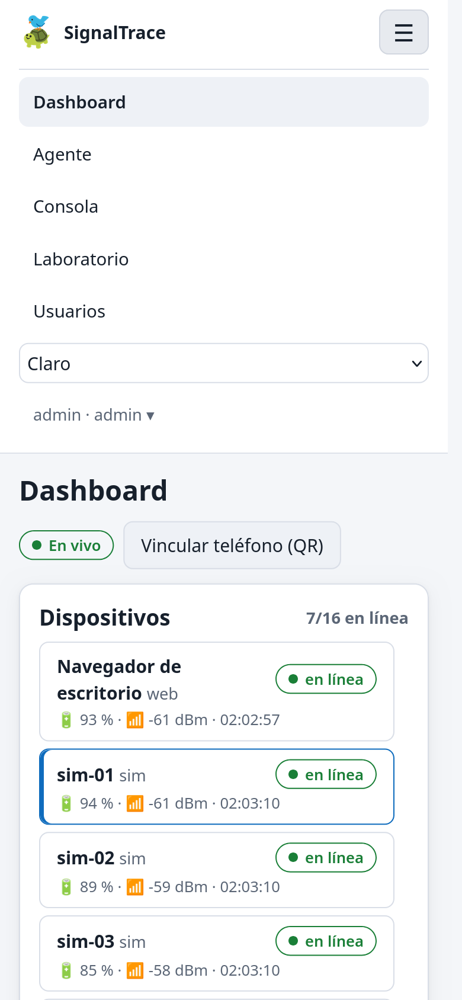
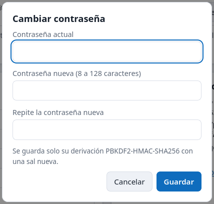
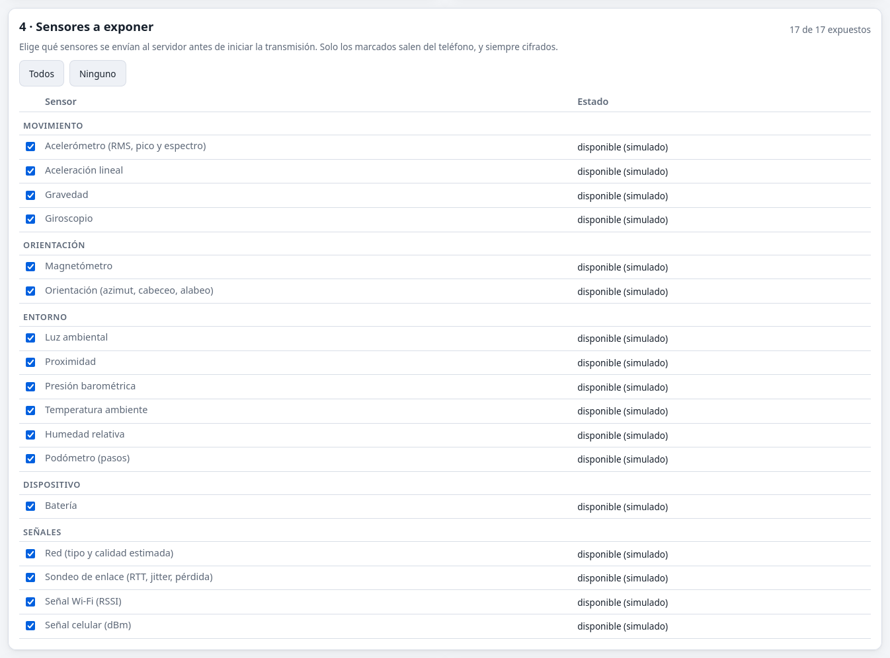
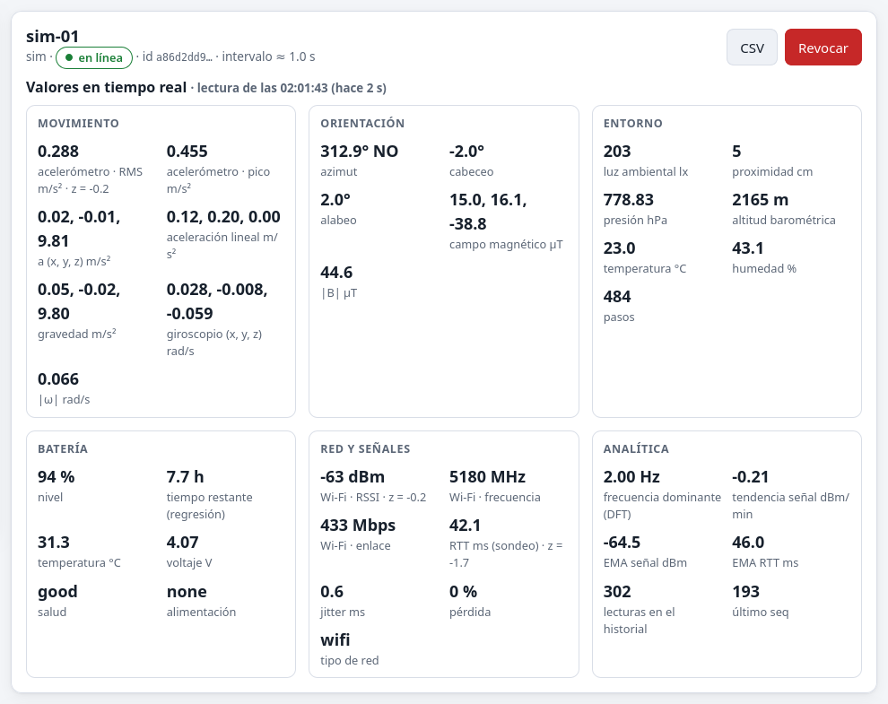
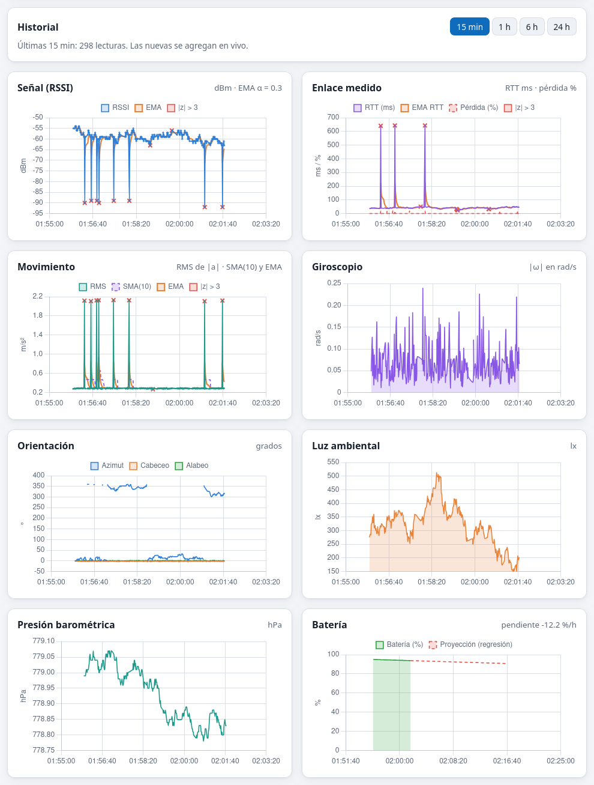
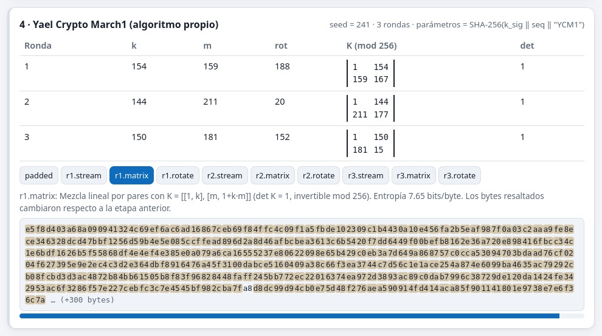

# Manual de instalación y uso

## Requisitos

- **Servidor:** .NET SDK 10.0.402 o superior (Linux, Windows o macOS). No hace falta instalar una base de datos, porque SQLite viene incluido.
- **Cliente web:** Chrome o Edge en Android o en escritorio. Firefox y Safari funcionan, pero exponen menos sensores (sin batería, tipo de red ni Generic Sensor API).
- **App Android:** Android 8.0 (API 26) o superior. Instalar `SignalTrace.apk` (hay que permitir «orígenes desconocidos»).
- Opcional: Node.js 20 o superior para las pruebas de JavaScript; Docker para el contenedor.

## 1. Arrancar el servidor

```
cd Examen_SignalTrace
dotnet run --project src/SignalTrace.Server --launch-profile http
```

- Escucha en `http://0.0.0.0:5090` y, para los teléfonos, en **`https://0.0.0.0:5443`** con un certificado autofirmado que genera en el primer arranque (`data/lan-cert.pfx`). Se desactiva con `Https:Enabled=false`.
- El usuario inicial es **`admin`** con la contraseña fija **`SignalTrace2026!`** (`Admin:Password` en `appsettings.json`). Se puede cambiar en la configuración antes del primer arranque o, después, desde el menú de usuario → «Cambiar contraseña».
- Imprime la **huella SHA-256** de la llave del servidor. Los clientes la comparan antes de fijarla (con el QR se comprueba sola).
- La documentación interactiva de la API está en `http://localhost:5090/scalar`.

## 2. Iniciar sesión

Abre `http://localhost:5090` e inicia sesión con `admin` / `SignalTrace2026!`.


**Usuarios** (solo admin):

- crear cuentas con rol `admin` o `viewer` (un viewer solo ve sus propios dispositivos);
- **cambiar el rol** de cada usuario con su selector (siempre debe quedar un administrador);
- **restablecer la contraseña** de otro usuario: se genera una aleatoria de 16 caracteres que se muestra una sola vez para copiarla;
- eliminar usuarios.

Cualquier usuario cambia **su propia contraseña** desde el menú con su nombre, arriba a la derecha → «Cambiar contraseña». Hay que escribir la actual.

En un teléfono la barra superior se reduce al logo y un botón **☰**, que despliega la navegación, el tema y el menú de usuario.






## 3. Agente web (navegador del teléfono o de la PC)

El teléfono necesita **contexto seguro** (HTTPS o `localhost`) para Web Crypto y los sensores.

**Forma más rápida: el QR.**

1. En el dashboard pulsa **Vincular teléfono (QR)**.
2. Escanéalo con la **cámara normal** del teléfono, conectado a la misma red. Es una URL `https://<IP>:5443/agent.html#enroll=…`.
3. El navegador avisa una vez del certificado autofirmado: elige «Avanzado → Continuar».
4. El agente comprueba que la llave del servidor coincida con la huella del QR, la fija y muestra **Vincular este teléfono**. No hace falta iniciar sesión: el código de un solo uso basta.

**Otras formas:**

- **Con sesión:** entra a `https://<IP>:5443/agent.html`, inicia sesión, pulsa **Registrar este navegador**, compara la huella con la del servidor y pulsa **Fijar huella**.
- **Con cable USB:** `adb reverse tcp:5090 tcp:5090` y `http://localhost:5090/agent.html`.

**Después, en el agente:**

1. Elige el intervalo y la suite (AES-256-GCM o ChaCha20-Poly1305). En una computadora activa **Modo simulador**.
2. En **Sensores a exponer**, marca los sensores que se enviarán. La tabla dice cuáles ofrece este navegador y cuáles solo existen en la app Android.
3. Pulsa **Iniciar**. La selección queda bloqueada mientras transmite. Mantén la pantalla encendida; si se bloquea, la telemetría queda en pausa.

La tarjeta «Transmitidos» muestra exactamente lo que viaja por la red.




## 4. App Android

1. Instala `SignalTrace.apk`.
2. En el dashboard web pulsa **Vincular teléfono (QR)**.
3. En la app ve a **Configurar → Escanear QR**. Es el mismo QR del agente web. La app hace lo siguiente:
   - toma la URL del servidor;
   - fija el certificado TLS por su huella;
   - fija la llave del servidor solo si coincide con la huella del QR;
   - canjea el código de un solo uso.
4. Como alternativa, escribe la URL, pulsa **Obtener llave del servidor**, compara y **fija la huella**, y registra el dispositivo con usuario y contraseña o con el código de 8 caracteres.
5. En **Ajustes → Sensores expuestos al servidor** decide qué sensores se envían. **Por defecto todos están activados.** Los que tu teléfono no tiene aparecen deshabilitados. Ahí también se eligen el intervalo y la suite.
6. En **Estado** pulsa **Iniciar**:
   - concede el permiso de notificaciones y, si el podómetro está activo, el de actividad física; si niegas uno, solo se apaga ese sensor. La app no pide la ubicación;
   - aparece una notificación permanente;
   - la telemetría sigue con la pantalla bloqueada;
   - para detenerla usa el botón **Detener** de la notificación.
7. Recomendado: **Ajustes → Abrir ajustes de batería**, para excluir la app de la optimización de batería.

## 5. Simulador (demo sin teléfono)

```
dotnet run --project src/SignalTrace.Simulator -- --user admin --password 'SignalTrace2026!' \
    --fingerprint <huella> --devices 6 --rate 1 --anomalies --gaps
```

- Cada dispositivo virtual genera todo el banco de sensores.
- `--anomalies`: caídas de señal, picos de RTT y vibración fuerte.
- `--gaps`: pausas como las de una pantalla bloqueada.
- `--transport mqtt`: usa el broker MQTT del servidor.
- `--suite chacha20-poly1305`: elige ChaCha20.

## 6. Dashboard


- **Dispositivos:** estado en línea o fuera de línea, batería, señal y última vez, actualizados en vivo por SignalR. Al seleccionar uno se ven sus valores y su historial.
- **Valores en tiempo real:** todos los sensores que expone el dispositivo, agrupados, actualizados con cada paquete y con la antigüedad de la última lectura:
  - **movimiento:** RMS y pico, ejes, aceleración lineal, gravedad, giroscopio y |ω|;
  - **orientación:** azimut con punto cardinal, cabeceo, alabeo y campo magnético;
  - **entorno:** luz, proximidad, presión con la altitud barométrica estimada, temperatura, humedad y pasos;
  - **batería:** nivel, tiempo restante (regresión), temperatura, voltaje y salud;
  - **red y señales:** Wi-Fi, celular, RTT, jitter, pérdida y descarga;
  - **analítica:** frecuencia dominante, tendencias, EMA y z-scores. Un valor con |z| > 3 se muestra en rojo.
- **Historial:** rango de 15 min, 1 h, 6 h o 24 h. Los rangos largos se muestrean para no saturar las gráficas. Gráficas:
  - RSSI con EMA, RTT y pérdida, movimiento con SMA y EMA;
  - giroscopio, orientación, luz, presión y batería con proyección;
  - espectro DFT y la **malla temporal interpolada**.
  - Una ✕ roja marca cada muestra anómala (|z| > 3).
- **Exportar:** CSV con todas las columnas. **Revocar** (admin) invalida el token del dispositivo y borra sus lecturas.






## 7. Consola de administrador

Muestra cada paquete que llega, aceptado o rechazado:

1. Bytes transmitidos.
2. Verificación: resultado, motivo, `seq` y tiempos en µs.
3. AEAD: nonce, AAD desglosado, etiqueta y texto cifrado.
4. Yael Crypto March1: tabla de rondas con k, m, rot y la matriz K; selector de etapa con los bytes que cambian resaltados.
5. Texto claro.

Incluye la entropía por etapa. **▶ Paso a paso** anima el recorrido de un paquete.





## 8. Laboratorio

**Ejecutar todos** corre los 12 escenarios del capítulo de escenarios y muestra la tabla esperado/obtenido. Cada escenario también se puede ejecutar por separado y muestra su bitácora.

## 9. Pruebas automáticas

```
dotnet test SignalTrace.slnx                      # Core (vectores, propiedades, criptoanálisis) y Server (integración y numéricos)
node --test "tests/web/*.test.mjs"                # cripto del navegador contra los vectores
node reference/verify.mjs                         # verificación independiente con Web Crypto
python3 reference/gen_vectors.py                  # regenera los vectores (Python + OpenSSL)
cd android && ./gradlew :app:testDebugUnitTest    # port Kotlin: vectores (+ servidor real si ST_TEST_SERVER)
```
