# Manual de instalación y uso

## Requisitos

- **Servidor:** .NET SDK 10.0.402 o superior (Linux, Windows o macOS). No hace falta instalar una base de datos, porque SQLite viene incluido.
- **Cliente web:** Chrome o Edge en Android o en escritorio. Firefox y Safari funcionan, salvo la batería y el tipo de red, que no tienen API.
- **App Android:** Android 8.0 (API 26) o superior. Instalar `SignalTrace.apk` (hay que permitir «orígenes desconocidos»).
- Opcional: Node.js 20 o superior para las pruebas de JavaScript; Docker para el contenedor.

## 1. Arrancar el servidor

```
cd Examen_SignalTrace
dotnet run --project src/SignalTrace.Server --launch-profile http
```

- Escucha en `http://0.0.0.0:5090`.
- En el primer arranque imprime **una sola vez** la contraseña del usuario `admin`. También se puede fijar con `--Admin:Password=…` o con la variable de entorno `Admin__Password`.
- Imprime la **huella SHA-256** de la llave del servidor. Anótala: los clientes la comparan antes de fijarla.
- La documentación interactiva de la API está en `http://localhost:5090/scalar`.

## 2. Iniciar sesión

Abre `http://localhost:5090` e inicia sesión con `admin`. En **Usuarios** se pueden crear más cuentas con rol `admin` o `viewer`. Un viewer solo ve sus propios dispositivos.

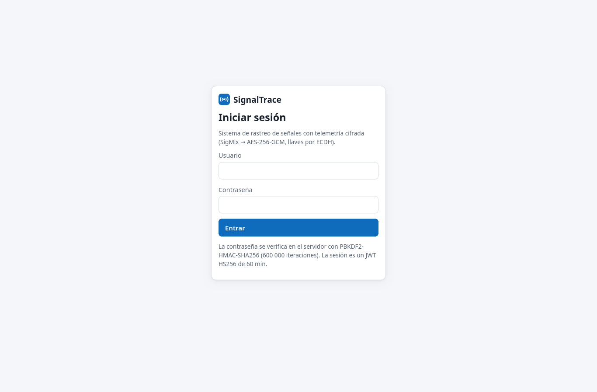

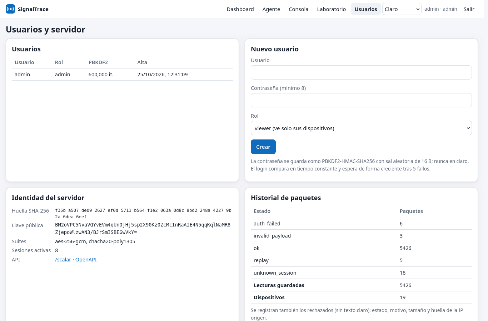

## 3. Agente web (navegador del teléfono o de la PC)

El teléfono necesita **contexto seguro** (HTTPS o `localhost`):

- **Con cable USB:** ejecuta `adb reverse tcp:5090 tcp:5090` y abre `http://localhost:5090/agent.html` en el teléfono.
- **Sin cable:** abre un túnel HTTPS, por ejemplo `cloudflared tunnel --url http://localhost:5090`, y usa la URL que imprime.

En el agente:

1. **Registra este navegador** como dispositivo.
2. **Compara la huella** que aparece con la del servidor, marca la casilla y pulsa **Fijar huella**.
3. Elige el intervalo, las fuentes y la suite (AES-256-GCM o ChaCha20-Poly1305). En una computadora activa **Simulador**.
4. Pulsa **Iniciar**. Mantén la pantalla encendida; si se bloquea, la telemetría queda en pausa.

La tarjeta «En el cable» muestra exactamente lo que viaja por la red.

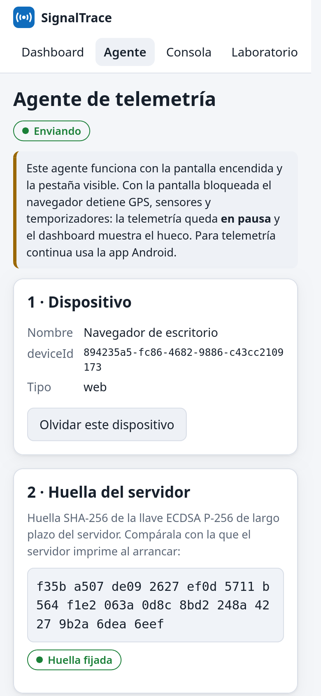

## 4. App Android

1. Instala `SignalTrace.apk`.
2. En el dashboard web pulsa **Vincular teléfono (QR)**.
3. En la app ve a **Configurar → Escanear QR**. El QR trae la URL del servidor, la huella de su llave y un código de un solo uso. La app solo fija la llave si coincide con la huella del QR.
4. Como alternativa, escribe la URL, pulsa **Obtener llave del servidor**, compara y **fija la huella**, y registra el dispositivo con usuario y contraseña o con el código de 8 caracteres.
5. En **Ajustes** elige el intervalo, las fuentes (GPS, movimiento, batería, red, sondeo, Wi-Fi, celular), la anonimización por HMAC y la suite.
6. En **Estado** pulsa **Iniciar**:
   - concede los permisos de ubicación, teléfono y notificaciones; si niegas uno, solo se apaga esa fuente;
   - aparece una notificación permanente;
   - la telemetría sigue con la pantalla bloqueada;
   - para detenerla usa el botón **Detener** de la notificación.
7. Recomendado: **Ajustes → Abrir ajustes de batería**, para excluir la app de la optimización de batería.

## 5. Simulador (demo sin teléfono)

```
dotnet run --project src/SignalTrace.Simulator -- --user admin --password <contraseña> \
    --fingerprint <huella> --devices 6 --rate 1 --anomalies --gaps
```

- `--anomalies`: caídas de señal, picos de RTT y vibración fuerte.
- `--gaps`: pausas como las de una pantalla bloqueada.
- `--transport mqtt`: usa el broker MQTT del servidor.
- `--suite chacha20-poly1305`: elige ChaCha20.

## 6. Dashboard

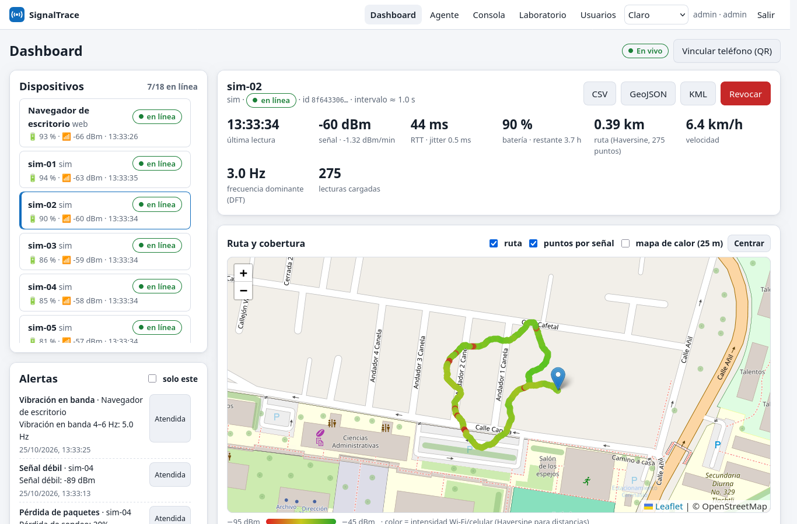

- **Dispositivos:** estado en línea o fuera de línea, batería, señal y última vez, actualizados en vivo por SignalR.
- **Mosaicos:**
  - última lectura;
  - señal con su tendencia (dBm/min);
  - RTT y jitter;
  - batería y tiempo restante (regresión);
  - distancia recorrida (Haversine);
  - velocidad;
  - frecuencia dominante (DFT).
- **Mapa:** ruta, puntos coloreados por intensidad de señal y mapa de calor de cobertura en celdas de 25 m.
- **Gráficas:** RSSI con su EMA, RTT y pérdida, movimiento con SMA y EMA, espectro, batería con proyección y la **malla temporal interpolada**.
- **Alertas:** se marcan como atendidas; las nuevas aparecen como aviso.
- **Exportar:** CSV, GeoJSON y KML. **Revocar** (admin) invalida el token del dispositivo y borra sus lecturas.

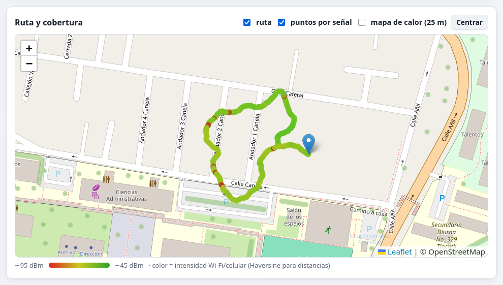

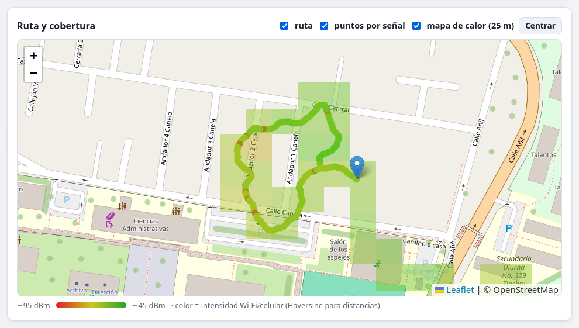

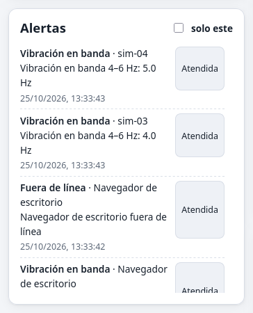

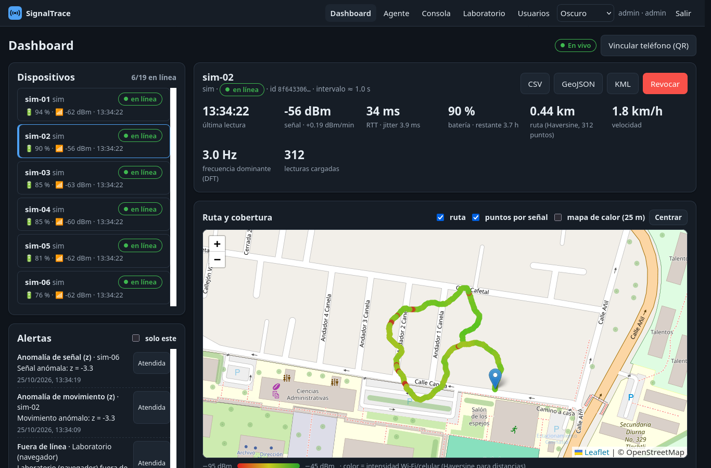

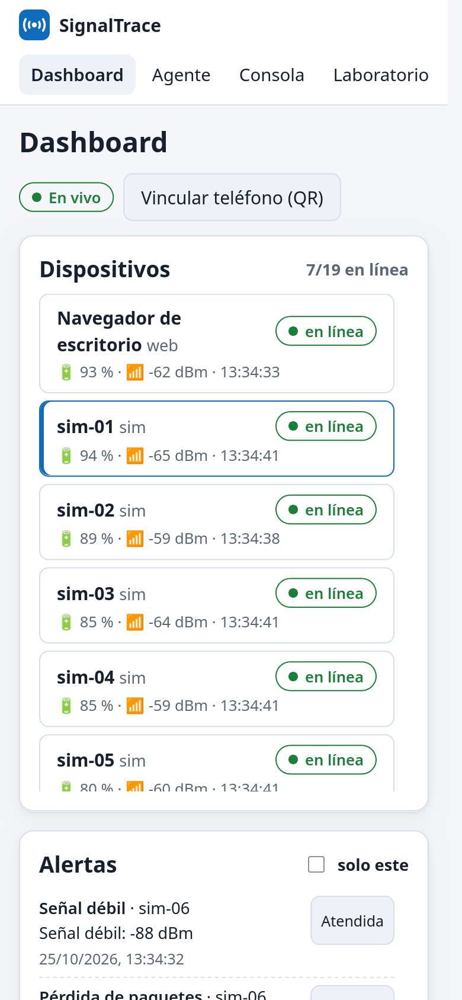

## 7. Consola de administrador

Muestra cada paquete que llega, aceptado o rechazado:

1. Bytes en el cable.
2. Verificación: resultado, motivo, `seq` y tiempos en µs.
3. AEAD: nonce, AAD desglosado, etiqueta y texto cifrado.
4. SigMix: tabla de rondas con k, m, rot y la matriz K; selector de etapa con los bytes que cambian resaltados.
5. Texto claro.

Incluye la entropía por etapa y un contraste con César. **▶ Paso a paso** anima el recorrido de un paquete.

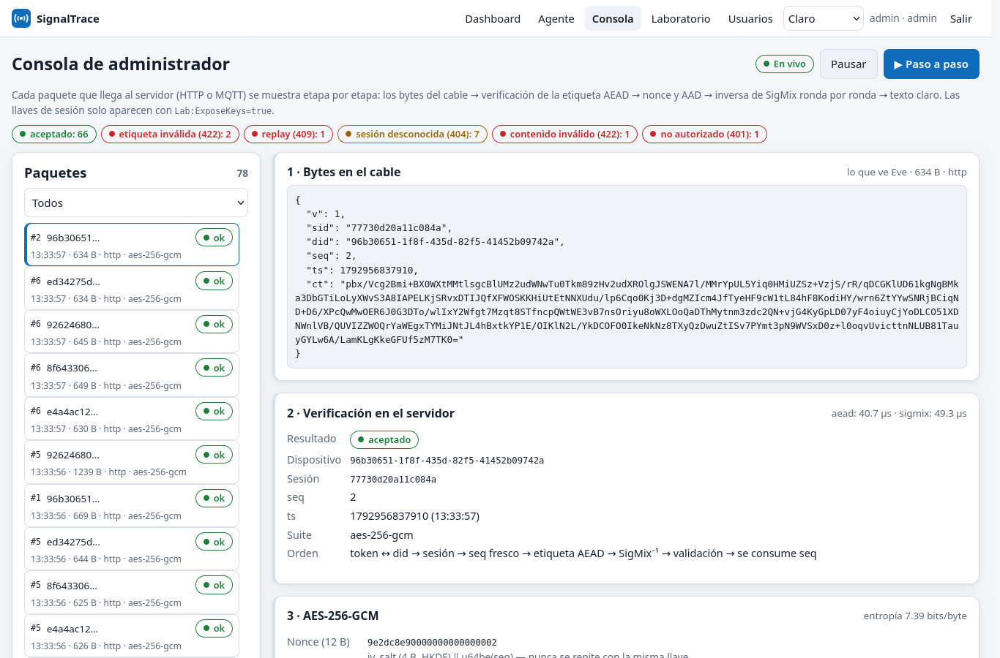

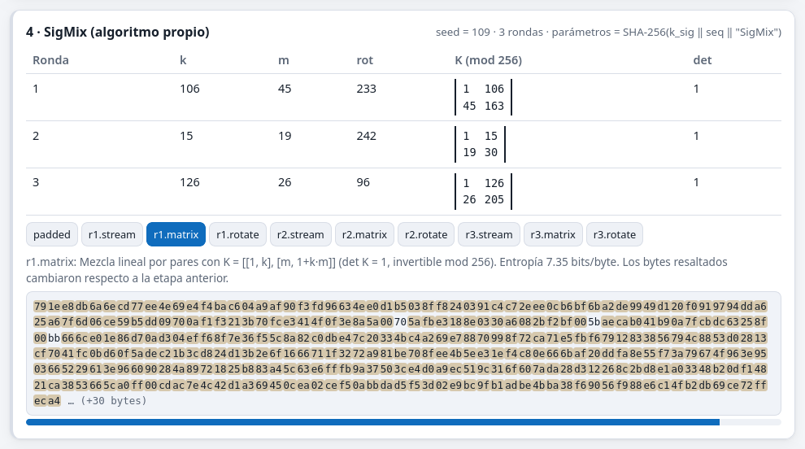

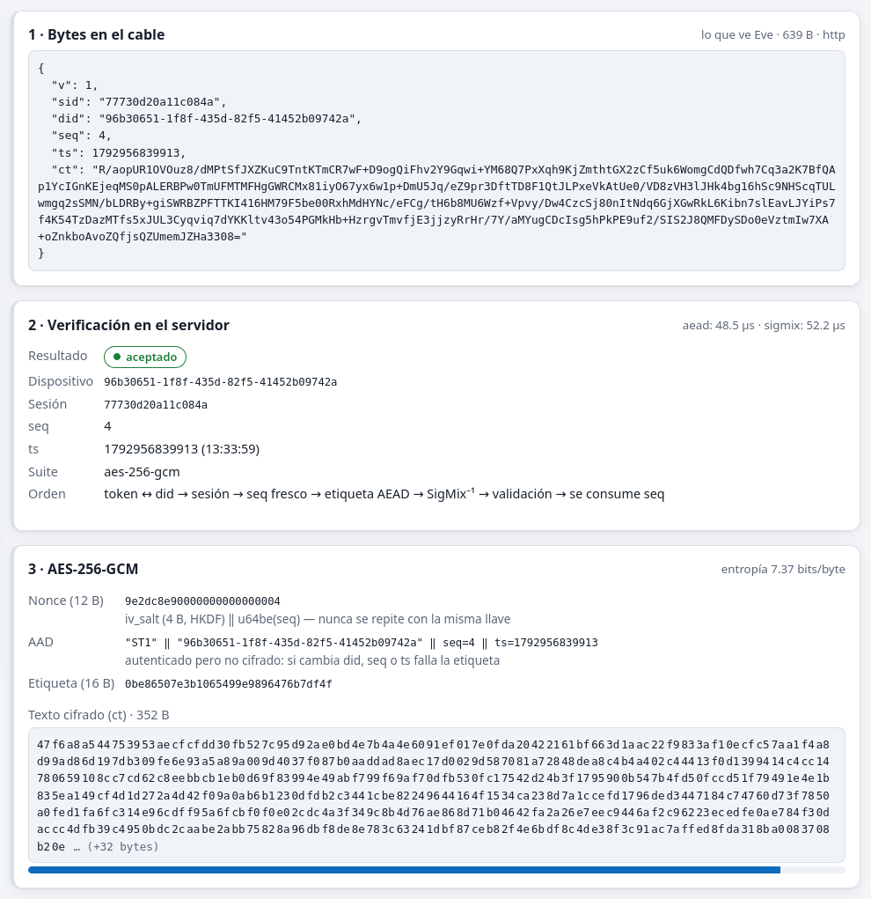

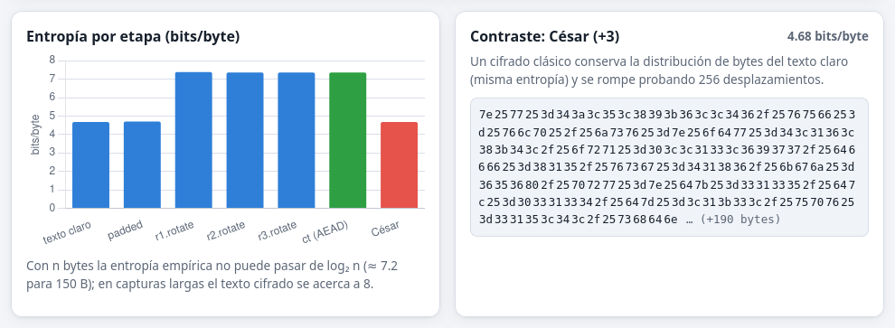

## 8. Laboratorio

**Ejecutar todos** corre los 13 escenarios del capítulo de escenarios y muestra la tabla esperado/obtenido. Cada escenario también se puede ejecutar por separado y muestra su bitácora.

## 9. Pruebas automáticas

```
dotnet test SignalTrace.slnx                      # Core (vectores, propiedades, criptoanálisis) y Server (integración y numéricos)
node --test "tests/web/*.test.mjs"                # cripto del navegador contra los vectores
node reference/verify.mjs                         # verificación independiente con Web Crypto
cd android && ./gradlew :app:testDebugUnitTest    # port Kotlin: vectores (+ servidor real si ST_TEST_SERVER)
```
