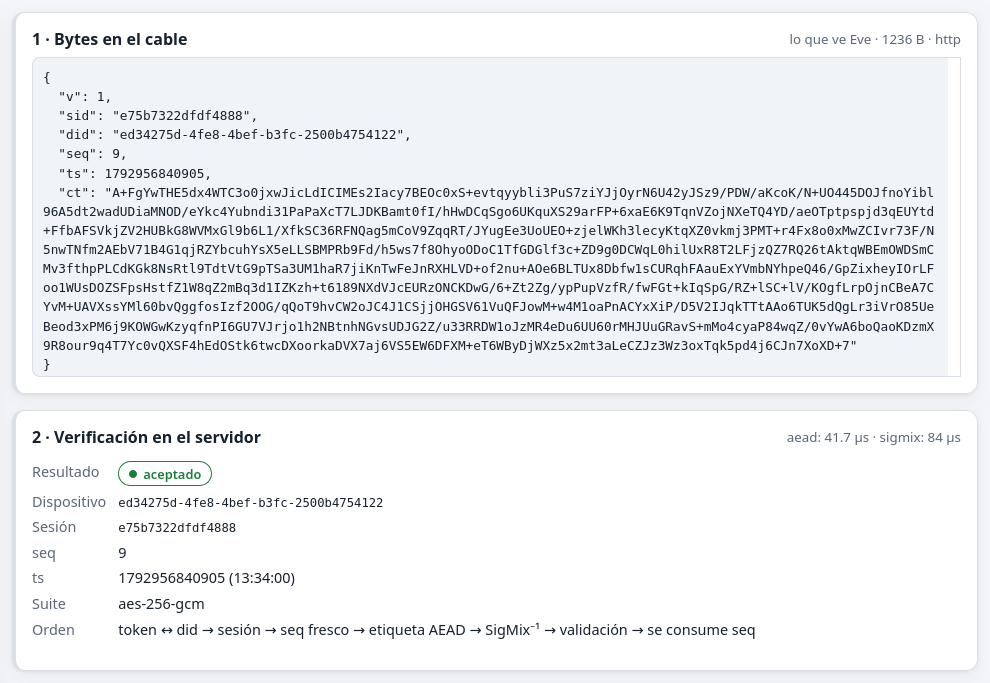

# Pruebas

La interoperabilidad se apoya en los **vectores de prueba** (`reference/test-vectors.json`). Se generaron con Python y `cryptography`/OpenSSL y se verificaron de forma independiente con Web Crypto. Las tres implementaciones del protocolo (C#, JavaScript y Kotlin) deben reproducirlos **byte a byte**. Todas las pruebas se ejecutaron el 25 de octubre de 2026 en la máquina de desarrollo.

## Resumen

| Suite | Herramienta | Pruebas | Resultado |
|---|---|---|---|
| Verificación independiente de los vectores | `node reference/verify.mjs` (Web Crypto) | 13 comprobaciones | ✅ todas |
| Core C#: vectores, propiedades y criptoanálisis | xUnit | 19 | ✅ 19/19 |
| Servidor: integración HTTP y SignalR, numéricos, datos | xUnit + WebApplicationFactory | 28 | ✅ 28/28 |
| Criptografía del navegador | `node --test` | 9 | ✅ 9/9 |
| App Android: vectores en Kotlin | JUnit (JVM) | 9 | ✅ 9/9 |
| App Android: flujo completo contra el servidor real | JUnit (JVM) + servidor en ejecución | 1 (≈ 12 comprobaciones) | ✅ |
| Escenarios de ataque en vivo | Laboratorio («Ejecutar todos») | 13 | ✅ 13/13 |
| Carga: simulador, 10 dispositivos a 1 Hz por HTTP | `SignalTrace.Simulator` | 201 paquetes | ✅ 200 aceptados, 0 rechazados (1 en vuelo al terminar) |
| Carga: MQTT con ChaCha20, 2 dispositivos | `SignalTrace.Simulator --transport mqtt` | 40 paquetes | ✅ 40/40 |
| Resistencia: 6 dispositivos, 10 min, anomalías y huecos | `SignalTrace.Simulator` | 3046 paquetes | ✅ 3046/3046, latencia media de 42.7 ms |

## Vectores de interoperabilidad

| Comprobación | C# | JS | Kotlin |
|---|---|---|---|
| ECDH: coordenada X del secreto compartido (desde ambos lados) | ✅ | ✅ | ✅ |
| HKDF: `st1/aes-up`, `st1/sigmix`, `st1/iv-up` | ✅ | ✅ | ✅ |
| Transcript del handshake y verificación de la firma ECDSA (y rechazo si se altera) | ✅ | ✅ | ✅ |
| SigMix: ejemplo de mano "Hi" → (236, 198) | ✅ | ✅ | ✅ |
| SigMix: parámetros, las 10 etapas intermedias y la salida del paquete | ✅ | ✅ | ✅ |
| Nonce, AAD y `ct‖tag` de AES-256-GCM idénticos al vector | ✅ | ✅ | ✅ |
| PBKDF2 con 600 000 iteraciones | ✅ | (Web Crypto en verify.mjs) | — |

## Propiedades

- `Descifrar(Cifrar(x)) = x` para longitudes de 0 a 199 bytes con datos y llaves aleatorios (C#, JS y Kotlin).
- Invertir cualquier bit del texto cifrado, o cambiar `seq` o `ts`, hace fallar la etiqueta (AES-GCM y ChaCha20).
- Los parámetros de SigMix son deterministas para un mismo `(k_sig, seq)` y distintos para otro `seq`.
- El LCG recorre los 256 estados (Hull–Dobell) y det K = 1 para los 65 536 pares (k, m).
- Un relleno inválido se rechaza.
- El ataque de texto claro conocido rompe SigMix de 1 ronda en 5 casos aleatorios.
- `ResolverLineal` y el inverso modular dan resultados correctos (5⁻¹ ≡ 205 mod 256; 2x ≡ 3 no tiene solución).

## Integración del servidor (HTTP real en memoria)

Login correcto e incorrecto; flujo completo con lectura visible; texto cifrado alterado (422) **sin consumir el `seq`**; replay (409); sesión desconocida (404); token de otro dispositivo (401); contenido inválido (422) sin consumir el `seq`; `t ≠ ts` (422); JSON mal formado (400); sin token (401); roles (viewer → 403, token de dispositivo → 403); MITM (el cliente rechaza la firma); llave pública de longitud inválida (400); suite ChaCha20; código de vinculación de un solo uso; ataque a SigMix en el laboratorio; reinicio de sesiones; SignalR autenticado (recibe `Reading` y `PacketTrace` con las 10 etapas, y rechaza conexiones anónimas); ventana anti-replay de 64 bits; cifrado en reposo; malla interpolada; mapa de calor; exportaciones CSV, GeoJSON y KML; alerta de señal baja.

## Métodos numéricos

| Prueba | Valor esperado | Obtenido |
|---|---|---|
| DFT de un seno de 5 Hz, f_s = 32 Hz, N = 64 | pico en k = 10 con magnitud 0.5 | ✅ |
| FFT radix-2 frente a DFT directa | iguales (error < 10⁻⁹) | ✅ |
| Interpolación de y = 2t + 1 con hueco | error 0, 2 puntos marcados | ✅ |
| Hueco de 10 intervalos | queda vacío | ✅ |
| Regresión sobre una recta exacta | a = 80, b = −0.5, r² = 1 | ✅ |
| Haversine (0,0)→(0,1) | 111 194.93 m | ✅ |
| Zócalo → Ángel de la Independencia | ≈ 3.6 km | ✅ |
| SMA, EMA y z-score | [1, 1.5, 2, 3, 4]; e₂ = 2.25; z = 3 | ✅ |

## Pruebas manuales en el navegador

- **Agente web:** registro, fijado de la huella, handshake y envío con AES-GCM y ChaCha20. También:
  - reinicio de sesiones → 404 → nuevo handshake;
  - servidor detenido unos 10 s → la cola guarda 15 lecturas, sobrevive a una recarga y se envía en orden sin rechazos;
  - vista de teléfono (375 px) sin desplazamiento horizontal.
- **Dashboard:**
  - 6 dispositivos en vivo con gráficas, espectro (pico en la frecuencia simulada de 2 Hz) y mapa;
  - mapa de calor y malla con 11 puntos interpolados y 11 en hueco;
  - alertas por z-score y umbrales, QR y exportaciones;
  - temas claro y oscuro, escritorio y teléfono, sin errores en la consola.
- **Errores encontrados y corregidos durante estas pruebas:**
  - el limitador de tasa se aplicaba por IP en lugar de por dispositivo;
  - el *backoff* del agente crecía con cada muestra en lugar de con cada reintento;
  - las pausas inflaban el intervalo nominal usado por la malla;
  - el ataque a SigMix solo recuperaba `rot mod n`.

